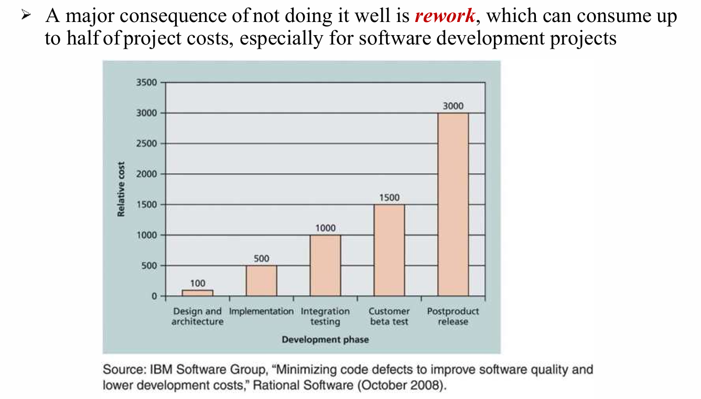
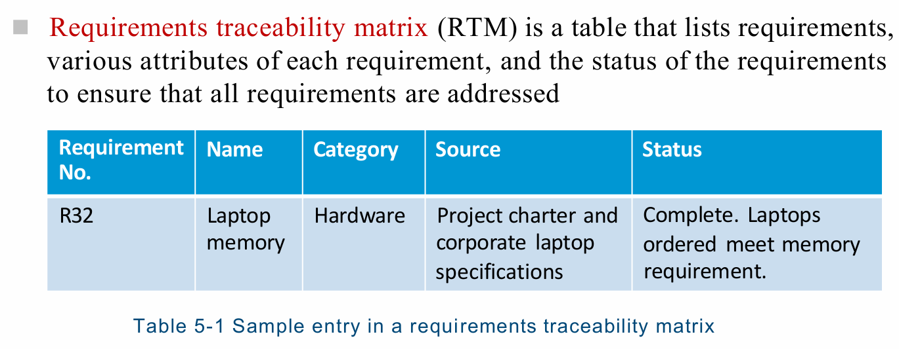

这是一份根据你提供的课件 lecture-3-project-scope-management-white-background.pdf 整理的《IT项目管理：项目范围管理》期末复习详尽讲义。考虑到你是软件工程专业的学生，讲义在涵盖所有考点的同时，也保留了针对软件项目的具体方法。

# 🎓 期末复习讲义：项目范围管理 (Project Scope Management)

## 核心概念与概述

* **范围 (Scope)**：指为了创造项目产品及其生产过程所涉及的所有工作。

* **可交付成果 (Deliverable)**：作为项目一部分而产生的产品。它可以是与产品相关的（如硬件或软件系统），也可以是与过程相关的（如规划文档或会议纪要）。

* **项目范围管理的定义**：包含定义和控制项目中“包含什么”和“不包含什么”的各个过程。它的主要作用是确保项目团队和干系人对项目将生产什么产品，以及使用什么过程来生产这些产品，保持完全一致的理解。

**范围管理的六大主要过程 (Six Main Processes)**
整个范围管理围绕以下六个生命周期过程展开，这是考试的骨架框架：

1. **规划范围管理 (Planning scope management)**：决定如何管理项目的范围和需求。

2. **收集需求 (Collecting requirements)**：定义并记录项目期间生产的产品的功能和特性，以及创建它们所使用的过程。

3. **定义范围 (Defining scope)**：通过审查项目章程、需求文档和组织过程资产来创建详细的范围说明书。

4. **创建工作分解结构 (Creating the WBS)**：将主要的项目可交付成果细分为更小、更易于管理的组件。

5. **确认范围 (Validating scope)**：正式验收完成的项目可交付成果。

6. **控制范围 (Controlling scope)**：在整个项目生命周期中控制对项目范围的变更。

---

## 过程 1：规划范围管理 (Planning Scope Management)

这是范围管理的第一步，主要规划在整个生命周期中如何管理项目的范围。

**主要输出文档：**

* **范围管理计划 (Scope management plan)**：它是项目管理计划的子计划。通常包括以下指导信息：

* 如何准备详细的项目范围说明书。

* 如何创建、批准和维护 WBS。

* 如何获得已完成可交付成果的正式验收。

* 如何控制对项目范围的变更请求。

* **需求管理计划 (Requirements management plan, RMP)**：记录将如何分析、记录和管理项目需求。包括：如何规划和跟踪需求活动、如何执行配置管理、如何排定需求优先级、如何使用产品指标，以及如何追踪需求属性。

**关于需求 (Requirement) 的关键知识点：**

* 需求被定义为“产品、服务或成果中为满足业务需求而必须具备的条件或能力”。

* 需求包含了发起人、客户和其他干系人的量化且已记录的需求和期望。

* **针对软件项目 (Software Projects)**：建议将需求开发划分为软件工程的四个步骤：**EASV**，即获取 (Elicitation)、分析 (Analysis)、规范/说明 (Specification) 和验证 (Validation)。

* 在项目的早期阶段，需求往往是不清晰的，因此使用**迭代的方法**来定义需求非常重要。

---

## 过程 2：收集需求 (Collecting Requirements)

收集需求通常是项目范围管理中最困难的一步，特别是对于软件开发项目而言。

* **返工的代价 (Cost of Rework)**：如果没有做好需求收集，会导致大量的返工，这可能会消耗高达一半的项目成本。如果在“设计和架构”阶段修复缺陷，成本是非常低的（相对成本为100）；而到了“集成测试”阶段（1000）或“客户Beta测试”阶段（1500），甚至“产品发布后”（3000），修复软件缺陷的成本呈指数级上升。因此，尽早理解需求至关重要。

**常用的收集需求方法 (Tools & Techniques)：**

* 访谈干系人 (Interviewing stakeholders)。

* 举行焦点小组和引导式研讨会 (Holding focus groups and facilitated workshops)。

* 使用群体创造力和决策技术 (Using group creativity and decision-making techniques)。

* 问卷调查和观察研究 (Questionnaires, surveys, and observation studies)。

* **标杆比对 (Benchmarking)**：通过比较特定的项目实践或产品特征来产生想法。

**需求跟踪矩阵 (Requirements Traceability Matrix, RTM)：**

* 定义：这是一个表格，列出了各项需求、每项需求的各种属性，以及需求的状态，以确保所有的需求都能得到解决。

* *补充示例*：RTM通常包含需求编号（如R32）、名称（如笔记本内存）、类别（如硬件）、来源（如项目章程）和当前状态（如已完成）。
* 

---

## 过程 3：定义范围 (Defining Scope)

这部分旨在提供项目所需工作的详细定义。良好的范围定义有助于提高时间、成本和资源估算的准确性，为绩效测量建立基准，并明晰工作职责。

**项目范围说明书 (Project Scope Statement) 的核心内容：**

* 范围说明书至少应包括：产品范围描述、产品用户验收标准，以及所有项目可交付成果的详细信息。

* 此外，记录项目边界、约束条件（Constraints）和假设条件（Assumptions）也很有帮助。

* 许多IT项目需要用于开发软件的详细功能和设计规范，这些应当在详细的范围说明书中被引用。

**渐进明细原则 (Progressive Elaboration)：**

* 随着时间的推移，项目范围应变得越来越清晰和具体。

* 项目团队可以对范围说明书的不同迭代进行命名，例如“版本1”、“版本2”等，并且这些更新可能要求其他项目文档（如采购计划）同步更新。

---

## 过程 4：创建工作分解结构 (Creating the WBS) —— 🌟 考试高频重点

WBS是为项目规划进度、成本、资源和变更奠定基础的最重要文档。许多专家认为，如果某项工作未包含在WBS中，就不应该在项目中执行。

**关键概念：**

* **定义**：WBS是对项目所涉及工作的一种以可交付成果为导向的分组，它定义了项目的总范围。

* **分解 (Decomposition)**：创建WBS的主要技术，即将项目可交付成果细分为更小的片段。

* **工作包 (Work Package)**：这是WBS最底层的任务，代表了项目监控和控制的工作级别。项目经理应该能在工作包级别清晰地估算完成所需的工作量、资源成本并评估结果质量。

* **范围基准 (Scope Baseline)**：WBS的主要输出之一。范围基准由“经过批准的项目范围说明书”、“WBS”和“WBS词典”共同组成。衡量项目范围目标的绩效正是基于此基准。

**开发 WBS 的五种方法 (Approaches to Developing WBS)：**

1. **使用指南 (Using guidelines)**：遵循组织提供的编制指南或模板（如PMI实践标准或微软Project模板）。

2. **类比法 (Analogy approach)**：审查类似项目的WBS，并将其裁剪以适用于当前项目。

3. **自上而下法 (Top-down approach)**：从项目最大的事项开始，将其逐级分解为下级事项。大多数项目经理认为这是传统方法，适合拥有广阔技术视野和全局观的经理。

4. **自下而上法 (Bottom-up approach)**：从尽可能多的具体任务开始，然后将其汇总并组织成更高层次的摘要活动。这种方法常用于代表全新系统或全新方法的项目，有助于团队产生协同效应，虽然耗时但非常高效。

5. **思维导图法 (Mind mapping)**：使用从核心概念向外辐射的分支来构建想法，这种更直观、结构化较弱的方法能激发个人的创造力并提高团队士气。

**WBS词典 (WBS Dictionary)：**

* 由于WBS中的许多条目描述非常模糊，WBS词典是一份描述每个WBS项详细信息的文档。

* 它澄清和解释了WBS中的简要描述，使项目成员更容易理解完成该工作所采取的方法和所包含/不包含的范围。

**创建 WBS 的基本原则 (Basic Principles)：**

* 一个工作单元只能在 WBS 中出现一次。

* 一个 WBS 项的工作内容等于其下方所有 WBS 项工作内容的总和。

* 一个 WBS 项仅由一个人负责（即便有许多人参与）。

* WBS必须与将要执行工作的方式保持一致，它应首先服务于项目团队。

* 项目团队成员必须参与 WBS 的开发以确保一致性和获得团队的认同 (buy-in)。

* 所有工作都应包含在WBS中，包括项目管理工作本身。

---

## 过程 5：确认范围 (Validating Scope)

在IT项目中，验证项目范围并尽量减少范围变更极其困难。

* **正式验收 (Formal Acceptance)**：范围确认涉及对已完成的项目可交付成果进行正式验收，通常通过客户的检查和对关键可交付成果的签字认可 (sign-off) 来实现。

* **范围蔓延 (Scope Creep)**：许多IT项目深受“范围蔓延”之苦，这指的是项目范围变得越来越大的趋势。

* **解决方案**：配置管理 (Configuration management) 和范围确认程序对于最小化范围变更至关重要。

---

## 过程 6：控制范围 (Controlling Scope)

控制范围在项目目标和业务战略的背景下管理对项目范围的变更。

* **控制目标**：影响导致范围变更的因素；确保变更根据综合变更控制中开发的程序进行处理；并在变更发生时对其进行管理。

* **偏差分析 (Variance Analysis)**：这是一种重要的数据分析工具，偏差指的是计划绩效与实际绩效之间的区别。

**🔥 考试高频应用题：IT项目中需求频繁变更或用户参与不足的应对建议**

1. **如何改善用户参与 (Improving user input)：**
* 制定良好的项目选择过程，坚持要求发起人来自用户所在的组织。

* 将用户纳入项目团队中。

* 定期召开具有明确议程的会议。

* 定期向用户和发起人交付一定的成果，保持反馈循环。

* 不要承诺团队在特定时间范围内无法交付的内容。

* 让用户与开发人员集中办公（地理位置上的接近有助于增进彼此的了解）。

2. **如何减少不完整和不断变更的需求：**
* 制定并遵循严格的“需求管理过程”。

* 采用原型法 (prototyping)、用例建模 (use case modeling) 和联合应用程序设计 (JAD) 等技术来吸引用户更多地参与。

* 将需求形成书面文件，并保持更新和易于获取。

* 创建需求管理数据库，用于记录和控制需求。

* 在整个项目生命周期中提供充分的测试。

* 从系统 (systems perspective) 的角度审查变更。

* 专门分配资源以处理变更请求。