这是一份为您量身定制的软件项目管理（进度管理部分）期末复习讲义。这部分内容在考试中通常占有很大比重，尤其是**网络图（ADM/PDM）\**和\**依赖关系**的理解，通常会结合计算题或画图题进行考察。

# 软件项目进度管理 (Project Schedule Management) 期末复习讲义

## 一、 为什么项目进度管理如此重要？ (Importance of Project Schedules)

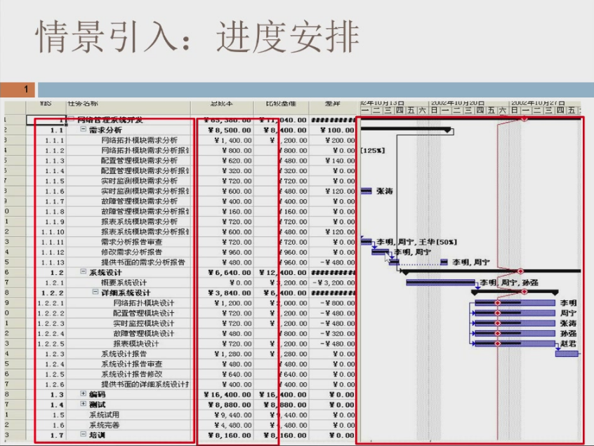

- **按时交付**项目是项目经理面临的最大挑战之一，也是导致冲突的主要原因。   
- 时间很容易被衡量和记忆，且无论项目发生什么，时间都是**最缺乏弹性**的（无法倒流或暂停）。   
- 个人的工作风格和文化差异（例如对假期的规定、对职业道德和时间表的认知）也会导致进度**冲突**。   
- **总结**：为了应对这些潜在的冲突，项目经理必须使用良好的项目进度管理，确保项目按时完成。常用的项目管理工具包括：甘特图 (Gantt charts)、网络图 (Network diagrams)、关键路径分析 (Critical path analysis) 和 关键链进度计划 (Critical chain scheduling)。   
- 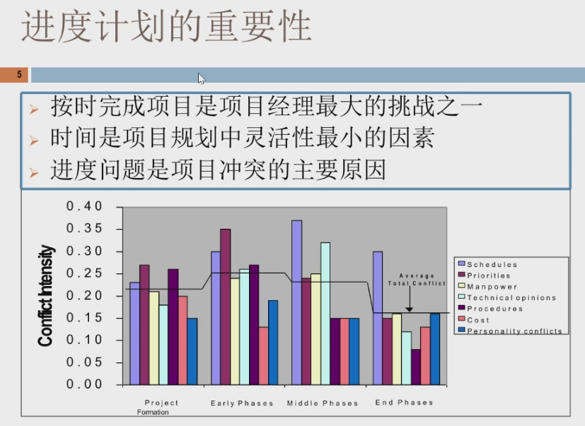

## 二、 进度管理的六个核心过程 (Six Main Processes)

考试中常考这六个过程的先后顺序及其主要输出内容：   

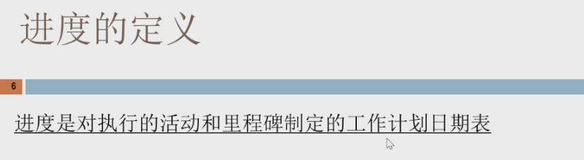

1. **规划进度管理 (Planning Schedule Management)**
2. **定义活动 (Defining Activities)**
3. **排列活动顺序 (Sequencing Activities)**
4. **估算活动持续时间 (Estimating Activity Durations)**
5. **制定进度计划 (Developing the Schedule)**
6. **控制进度 (Controlling the Schedule)**

### 过程 1：规划进度管理 (Planning Schedule Management)

- **概念**：决定将用于规划、执行和控制项目进度的政策、程序和文档。这是整个进度生命周期的第一步。   
- **主要输出**：进度管理计划 (Schedule management plan)。   
- **进度管理计划的内容**（可正式/详细，也可非正式/粗略）：   
  - **进度模型开发 (Project schedule model development)**：包含活动及其估算持续时间、依赖关系等。   
  - **准确度级别和计量单位 (Level of accuracy and units of measure)**：例如时间是以小时还是以天来衡量。   
  - **控制临界值 (Control thresholds)**：例如设立 +/- 10% 的偏差临界值来监控进度表现。   
  - **绩效测量规则 (Rules of performance measurement)**：明确如何追踪和确定已完成工作的百分比。   
  - **报告格式 (Reporting formats)**。   
  - **过程描述 (Process descriptions)**。   

### 过程 2：定义活动 (Defining Activities)

- **概念**：识别项目团队和干系人必须执行的具体行动，以产生项目可交付成果。   

- **与WBS的关系**：活动列表和活动属性必须与工作分解结构（WBS）和 WBS 词典保持一致。团队必须先理解每个 WBS 项的含义，然后才能做出与进度相关的决定。   

- **主要输出**：   

  - **活动列表 (Activity list)**：包含活动名称、标识符/编号和简短描述。活动是 WBS 中通常具有预期持续时间、成本和资源要求的具体工作元素。
  - **活动属性 (Activity attributes)**：提供与进度相关的信息，如前导活动、后续活动、逻辑关系、资源要求、约束条件等。
  - **里程碑列表 (Milestone list)**：里程碑是一个没有持续时间 (no duration)的重大事件。它通常作为完成重要阶段或可交付成果的标志（例如：获得客户对关键文档的签字）。*考试注意：区分“活动（有时间有资源）”与“里程碑（零持续时间，代表状态或检查点）”*。   

  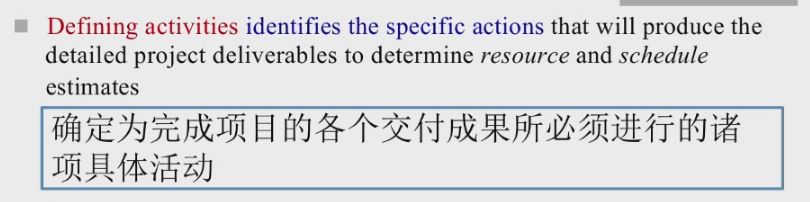

  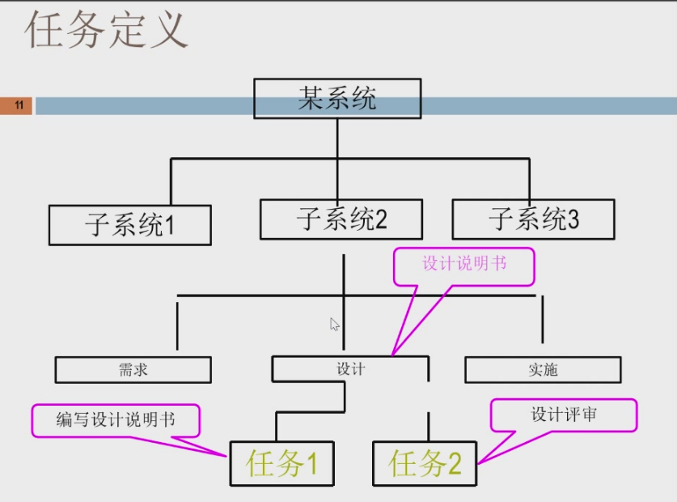

### 过程 3：排列活动顺序 (Sequencing Activities) —— **🌟考试重点**

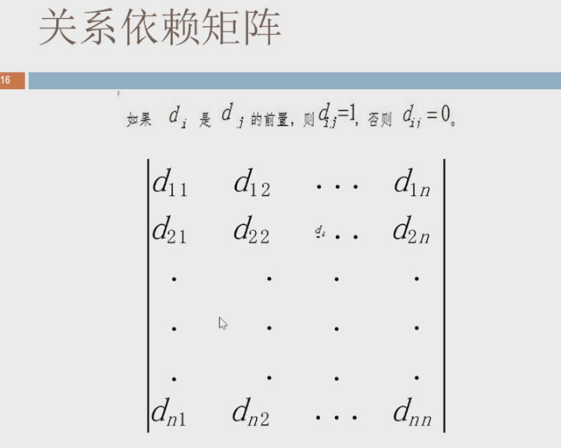

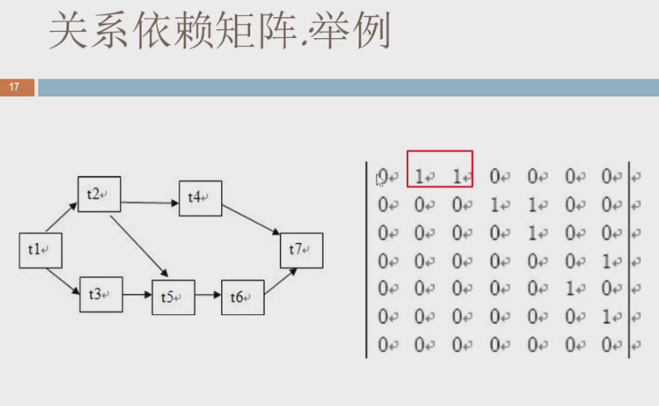

- **概念**：识别并记录项目活动之间的逻辑关系（依赖关系）。   

- **四种依赖关系 (Dependencies/Relationships)**：   

  1. **强制性依赖关系 (Mandatory dependencies)**：工作性质固有的，又称“硬逻辑 (hard logic)”。**例子**：必须先写完代码，才能测试代码。
  2. **选择性依赖关系 (Discretionary dependencies)**：由项目团队定义的，又称“软逻辑 (soft logic)”。**例子**：规定必须正式签署项目章程后，才能开始项目规划。
  3. **外部依赖关系 (External dependencies)**：项目活动与非项目活动之间的关系。**例子**：等待外部供应商交付新硬件后，才能安装软件。
  4. **内部依赖关系 (Internal dependencies)**：通常在项目团队控制范围内的活动关系。**例子**：完成单元测试后才能进行系统测试。

- **网络图 (Network Diagrams)**：展示活动逻辑关系的图形。主要有两种格式：   

  - **ADM (箭线图法 / 节点图 / 双代号网络图)**：   

    - **特点**：**箭头表示活动 (Activity-on-arrow, AOA)**，节点（圆圈）表示活动的起点或终点。   
    - **绘制规则**：必须从左到右绘制；箭头应向右指且不能交叉；会存在“发散 (bursts)”（一个节点引出多个活动）和“汇聚 (merges)”（多个节点汇入一个节点）。   
    - **局限性**：只能表示“完成-开始 (FS)”关系，且经常需要使用虚活动 (Dummy activities)来表示逻辑关系（虚活动用虚线箭头表示，没有持续时间和资源，时间标记为0）。  
    - 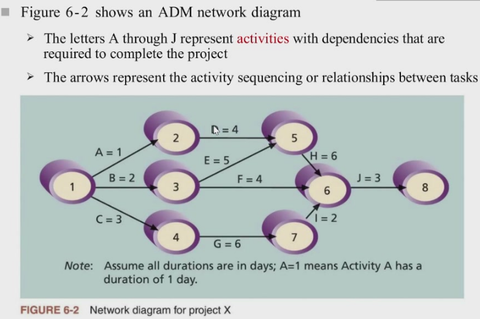 

    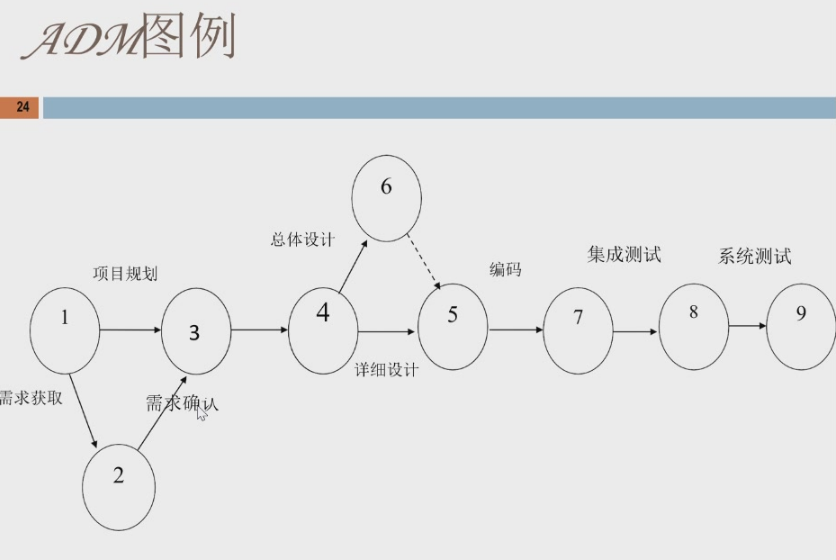

    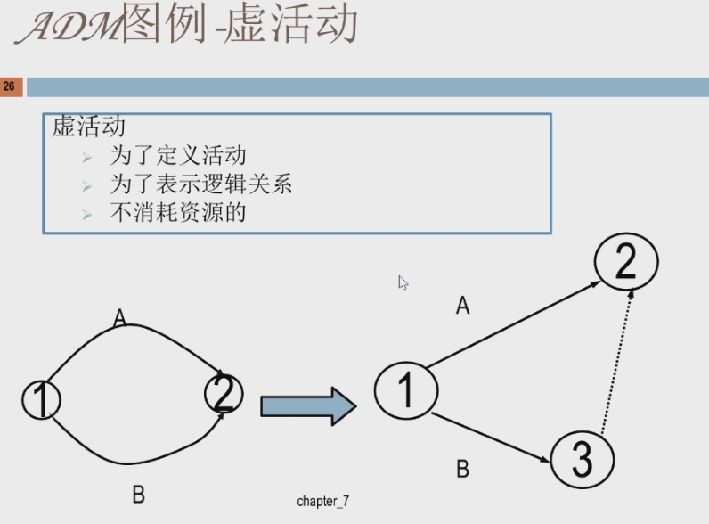

    > 有可能2后面还有C->4、D->5。如果是左边那种，意味着4、5同时依赖于A、B的完成，但是实际上可能不是这样（而是只依赖于A的完成）。拆开以后，可以表示完成了A以后就可以做C、D了、2、3本质上是同一个状态。

    真题（？）就是画个拓扑图

    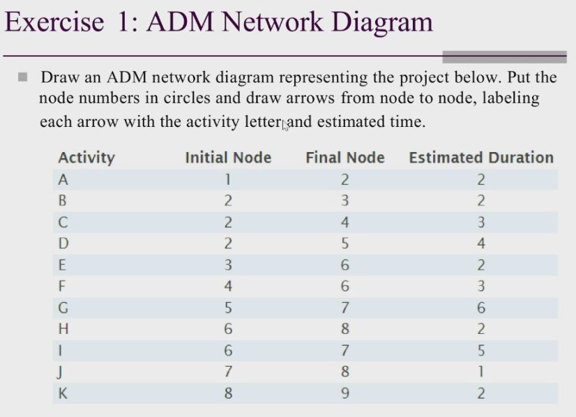

    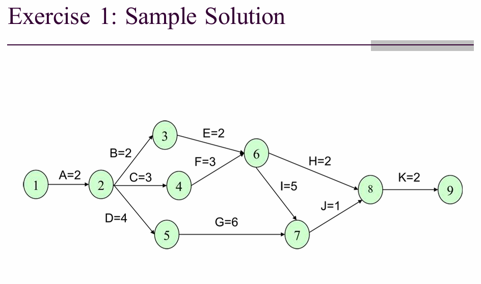

  - **PDM (紧前关系绘图法 / 单代号网络图)**：   

    - **特点**：**方框或圆圈表示活动 (Activity-on-node, AON)**，箭头表示活动之间的逻辑关系。目前大多数项目管理软件（如 Microsoft Project）都使用 PDM。   

    - **四种任务依赖类型**：   

      1. **完成-开始 (Finish-to-start, FS)**：任务 A 完成后，任务 B 才能开始（最常见）。
      2. **开始-开始 (Start-to-start, SS)**：任务 A 开始后，任务 B 才能开始。
      3. **完成-完成 (Finish-to-finish, FF)**：任务 A 完成后，任务 B 才能完成。
      4. **开始-完成 (Start-to-finish, SF)**：任务 A 开始后，任务 B 才能完成。

      > | 类型          | 逻辑关系                         | 软件开发中常见情景                                           |
      > | :------------ | :------------------------------- | :----------------------------------------------------------- |
      > | FS：完成-开始 | 前置任务完成后，后续任务才能开始 | 需求评审完成 → 开发开始；编码完成 → 测试开始；验收通过 → 上线发布 |
      > | SS：开始-开始 | 前置任务开始后，后续任务才能开始 | 需求分析开始 → 测试计划编写开始；编码开始 → 代码审查/静态扫描开始；前端开发开始 → 后端开发开始 |
      > | FF：完成-完成 | 前置任务完成后，后续任务才能完成 | 编码完成 → 代码审查完成；功能开发完成 → 用户手册定稿；缺陷修复完成 → 测试报告完成 |
      > | SF：开始-完成 | 前置任务开始后，后续任务才能完成 | 新系统上线开始 → 旧系统下线完成；新版本发布开始 → 旧版本停止支持完成；新服务开始接流量 → 旧服务下线完成 |

    - 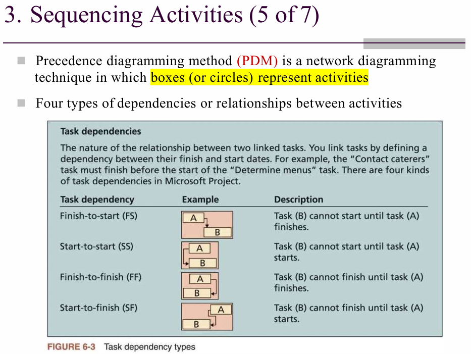

    - **相比 ADM 的优势**：可以显示任务之间的多种依赖关系（不仅限于FS）；**不需要使用虚活动 (Dummy activities)**。   

    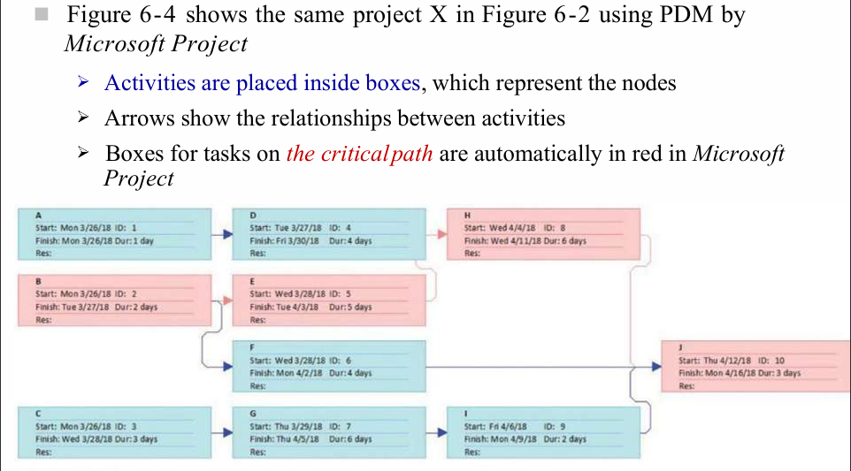

    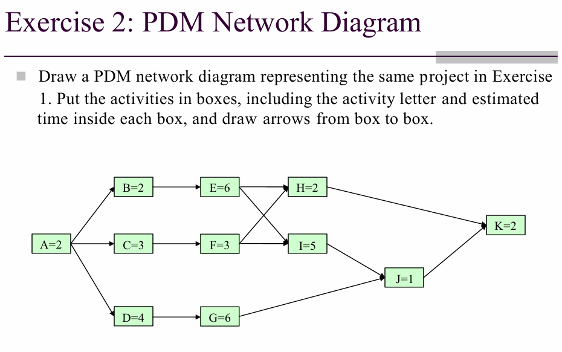

    > 老师说ADM和PDM必定考一个

    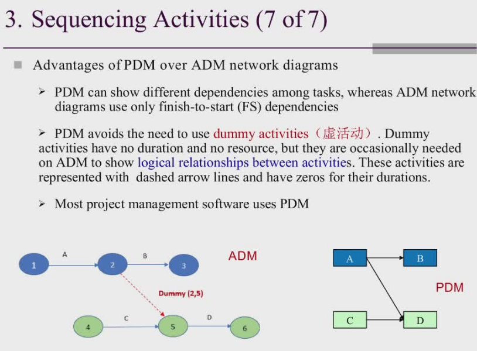

### 过程 4：估算活动持续时间 (Estimating Activity Durations)

- **核心概念区分 (Duration vs. Effort) —— 🌟极易考辨析题**：   
  - **持续时间 (Duration)**：指完成一项活动所经过的实际时间总和，包括**实际工作时间加上流逝的时间 (elapsed time)**。
  - **工作量/投入 (Effort)**：指完成一项任务所需的**工作日或工作小时数**。
  - **例子**：如果你计划花 20 个小时阅读一本书，但你打算在两个月内读完。那么“两个月”就是持续时间 (Duration)，“20个小时”就是工作量 (Effort)。   
- **估算方法**：   
  - 持续时间估算通常以离散数字、范围或**三点估算 (three-point estimate)** 的形式提供。三点估算包含乐观、最可能和悲观估算，是执行 PERT 估算和蒙特卡洛模拟所必需的。   
  - 其他技术包括：类比估算、参数估算、储备分析和专家判断。   
  - 估算时应让实际执行工作的人员拥有很大的发言权，并充分考虑资源（特别是人力资源）的可用性。   

**💡 考前冲刺建议：** 强烈建议您在纸上练习画出 **ADM** 和 **PDM** 网络图（参考课件中的 Exercise 1 和 2）。考试极大概率会给出一张包含活动名称、前导活动和持续时间的表格，要求您画出对应的网络图并找出关键路径（Critical Path，即总持续时间最长的一条路径，决定了项目的最短工期）。祝您复习顺利，期末取得好成绩！   