这是一份为您量身定制的软件项目管理（进度管理部分 Part II）期末复习讲义。这部分内容涵盖了进度管理的最后两个关键过程，其中**关键路径法 (CPM)**、进度压缩技术（赶工与快速跟进）以及 **PERT 估算公式**是考试中的绝对高频考点，通常会结合计算题进行考察。

# 软件项目进度管理 (Project Schedule Management) 期末复习讲义 (Part II)

## 三、 过程 5：制定进度计划 (Developing the Schedule)

- **概念**：利用前四个进度管理过程的结果，来确定项目及其各项活动的开始和结束日期。   
- **目标**：创建一个现实的、可行的项目进度计划，为监控项目时间维度的进展提供基础。   
- **主要输出**：进度基准 (Schedule baseline)、项目进度计划、进度数据等。   
- **四大核心工具和技术**（**🌟考试重点，需熟练掌握每种工具的特点**）：   
  1. 甘特图 (Gantt charts)
  2. 关键路径分析 (Critical path analysis)
  3. 关键链进度计划 (Critical chain scheduling)
  4. 计划评审技术 (PERT analysis)

***

### PPT特有内容

预留管理：

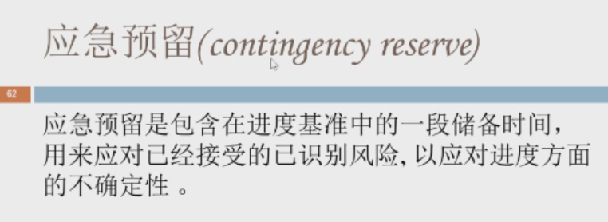

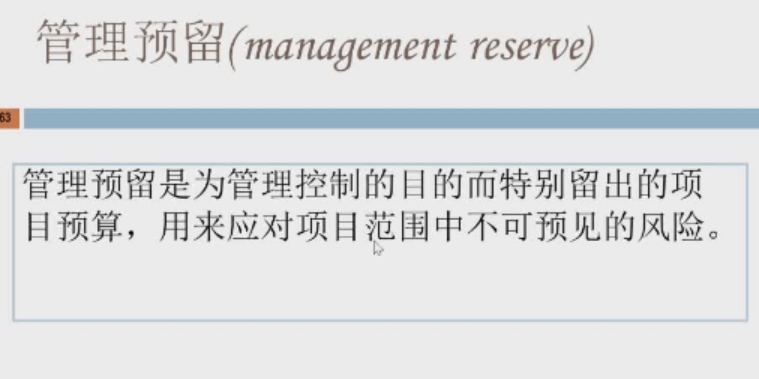

> **给年轻专业人士的建议**
>
> ■ 有些人觉得估算很有挑战性，尤其是估算自己的工作。然而，培养这项技能**非常重要**。
>
> ■ 练习估算你完成不同活动需要多长时间，然后进行实际测量
>    i. **详细定义活动**将帮助你更好地估算活动的每一个部分
>    ii. 不要害怕在估算时寻求帮助。有经验的人可以帮助我们做出**更切合实际**的估算。
>    iii. 从估算一些简单的活动开始，比如写报告、安排会议或制作演示文稿。
>
> ■ 如果你意识到某项活动的估算可能**不**准确，请尽快告知你的团队，以便在项目早期做出调整。

***

### 1. 甘特图 (Gantt Charts) 与里程碑

> 老师说考试不会考手绘甘特图

- **基本特征**：以日历的形式列出项目活动及其对应的开始和结束日期，提供了展示进度信息的标准格式。通常也被称为条形图 (bar charts)。   

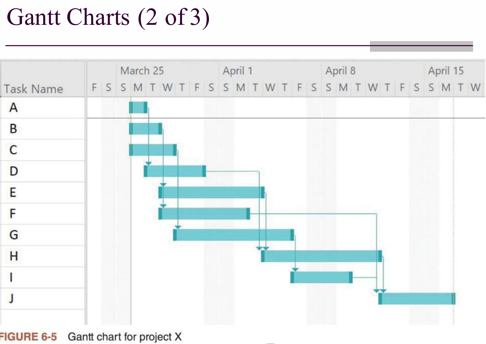

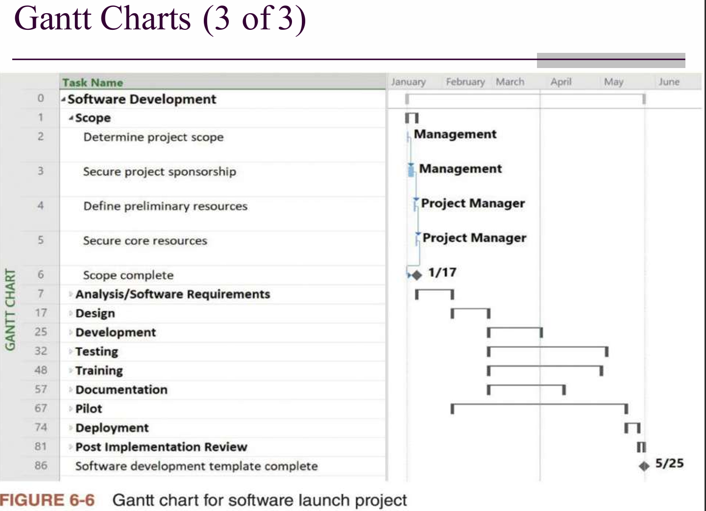

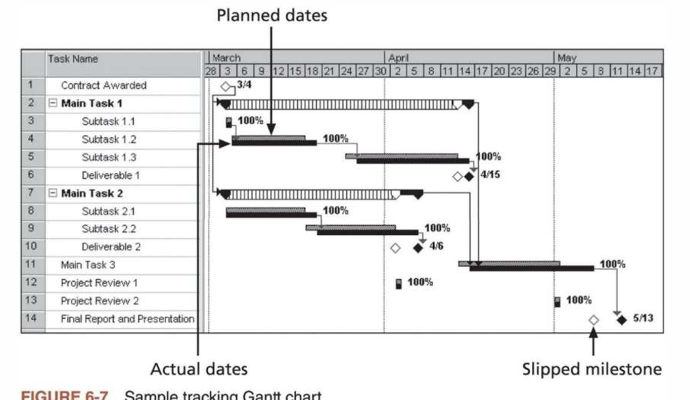

- **甘特图上的常见符号**：   
  - **黑色菱形 (Black diamond)**：代表里程碑 (Milestone)。
  - **两端带有矩形的粗黑条**：代表摘要任务 (Summary tasks)。
  - **浅蓝色条**：代表任务的持续时间 (Durations)。
  - **箭头**：显示任务之间的关系或依赖性。
- **创建有意义的里程碑的 SMART 原则**（常考简答题或选择题）：   
  - **S**pecific (具体的)：针对一个具体的目标。
  - **M**easurable (可衡量的)：针对一个可量化的目标。
  - **A**ssignable (可分配的)：明确由谁来做并对最终交付负责。
  - **R**ealistic (现实的)：在现有资源下切实可行。
  - **T**ime-bound (有时限的)：明确必须完成里程碑的截止日期。
- **跟踪甘特图 (Tracking Gantt Chart)**：
  - **用途**：用于比较计划（基准）和实际的项目进度信息。   
  - **读取方法**：通常包含两条水平条。**上方**的条代表计划（或基准）持续时间，**下方**的条代表实际持续时间。   
  - **白色菱形 (White diamond)**：代表滑移的里程碑 (Slipped milestone)，即比~~原计划晚完成的里程碑~~。   【实际上应该是预定完成的里程碑，黑色的才是实际（晚）完成的】

### 2. 关键路径法 (Critical Path Method, CPM) —— **🌟必考计算题**

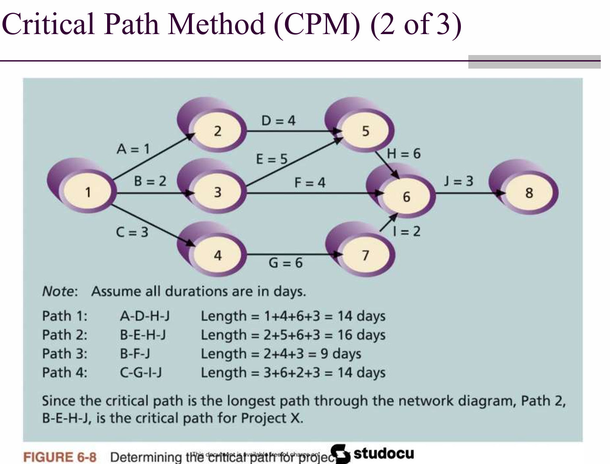

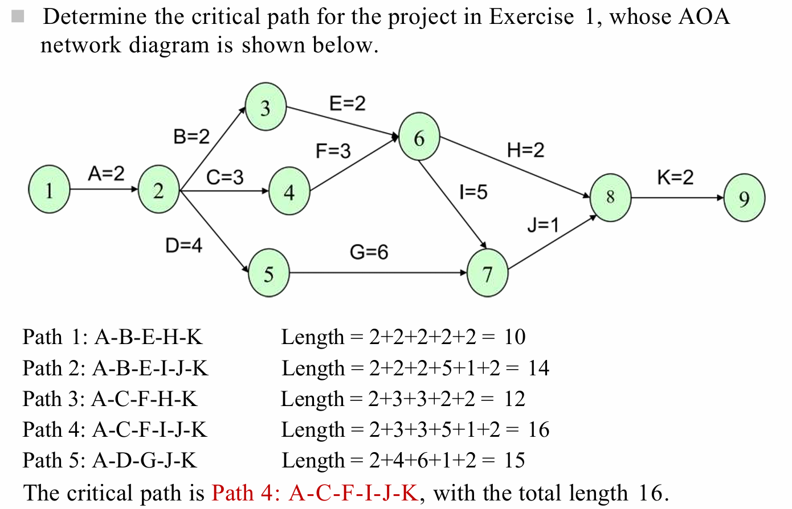

- **核心定义辨析**（极易考判断题/选择题）：   
  - **关键路径 (Critical Path)**：是一系列决定项目**最早可能完成时间 (earliest time)** 的活动。   
  - 它是网络图中**最长 (longest)** 的路径，但它代表了完成项目所需的**最短 (shortest)** 时间。   
  - 关键路径上的活动**浮动时间/宽裕时间最少 (least amount of slack or float)**。   
  - *注：“关键”并不意味着它包含了所有“最重要”的活动，而是仅关注项目的时间维度*。   
- **关键路径的动态性**：一个项目可以有多条关键路径（如果几条路径总时长相同）；随着项目的进展，如果非关键路径上的活动延期，关键路径是会发生变化的。   
- **浮动时间/宽裕时间 (Slack / Float)**：   
  - **自由浮动时间 (Free slack/float)**：在不延迟任何**紧后活动的最早开始时间 (ES)** 的前提下，一项活动可以推迟的时间量。   
  - **总浮动时间 (Total slack/float)**：在不延迟**项目计划完成日期**的前提下，一项活动可以从其最早开始时间推迟的时间量。   
  - *规律*：自由浮动时间不能大于其总浮动时间。   
  - **推算方法**：项目经理通过在网络图中进行**顺推 (forward pass)**（确定最早开始ES和最早完成EF）和**逆推 (backward pass)**（确定最晚开始LS和最晚完成LF）来计算所有活动的浮动时间。   

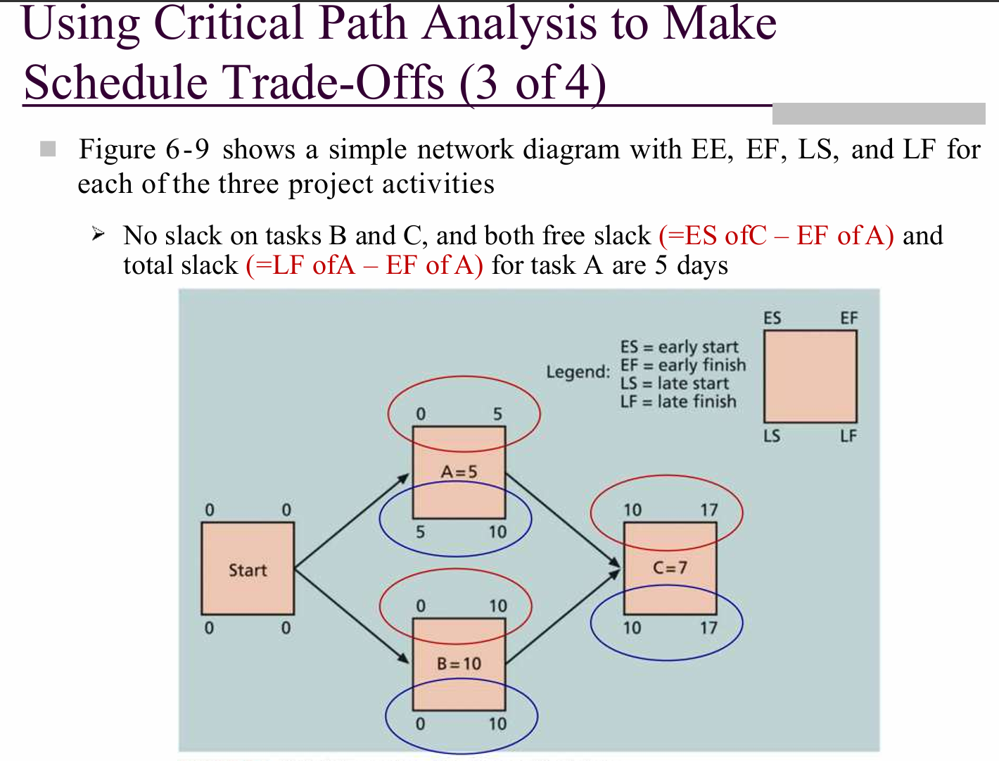

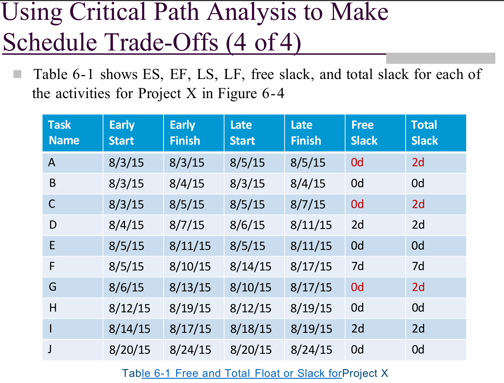

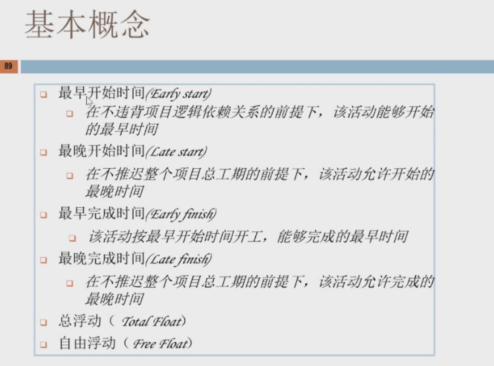

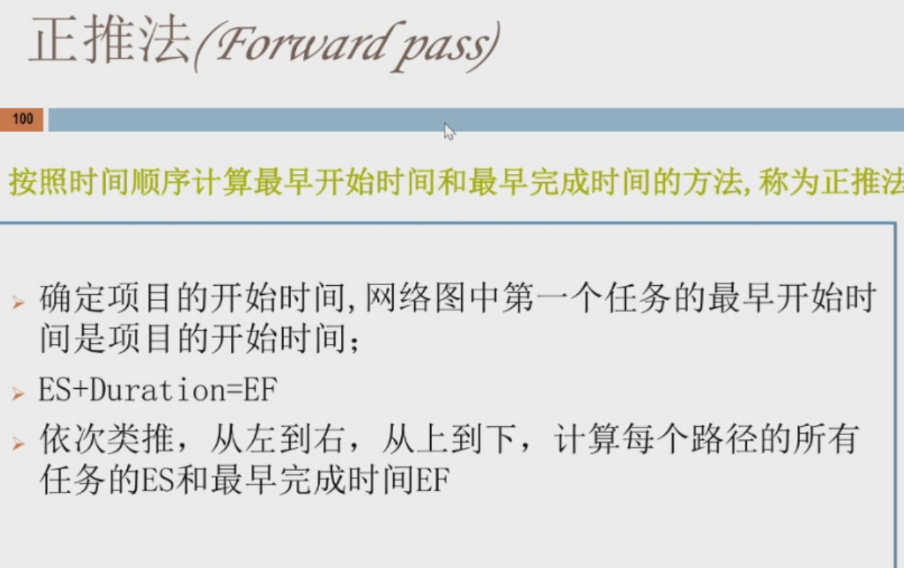

> 注意最右边的方块的ES=17=max(10,17)

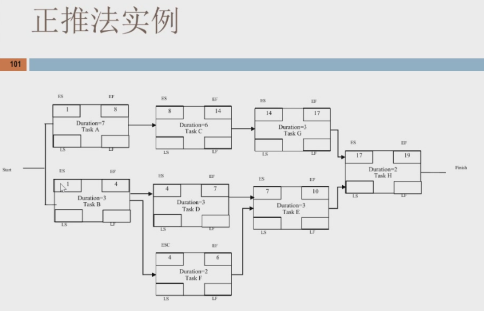

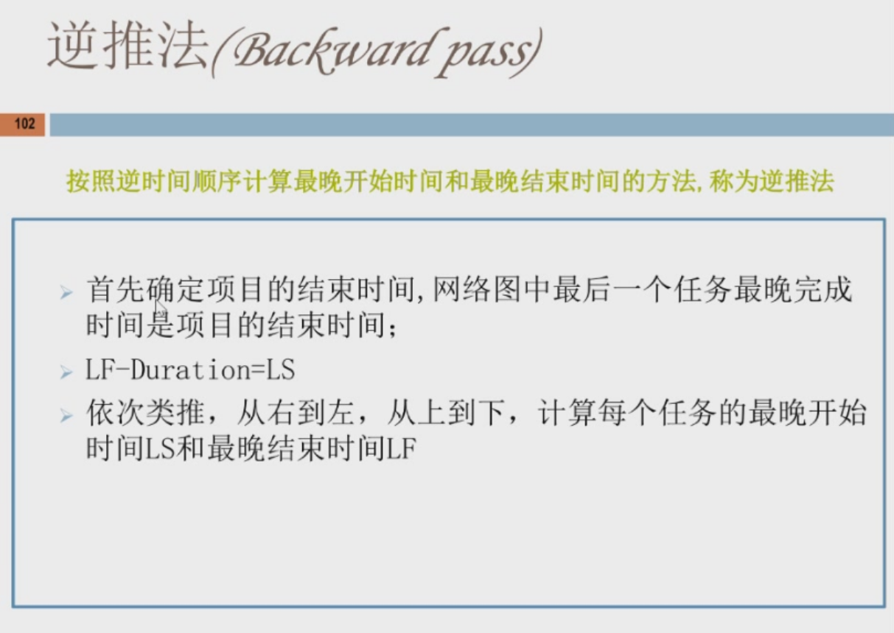

> 注意TaskB的LF=11=min(11,12)而不是12

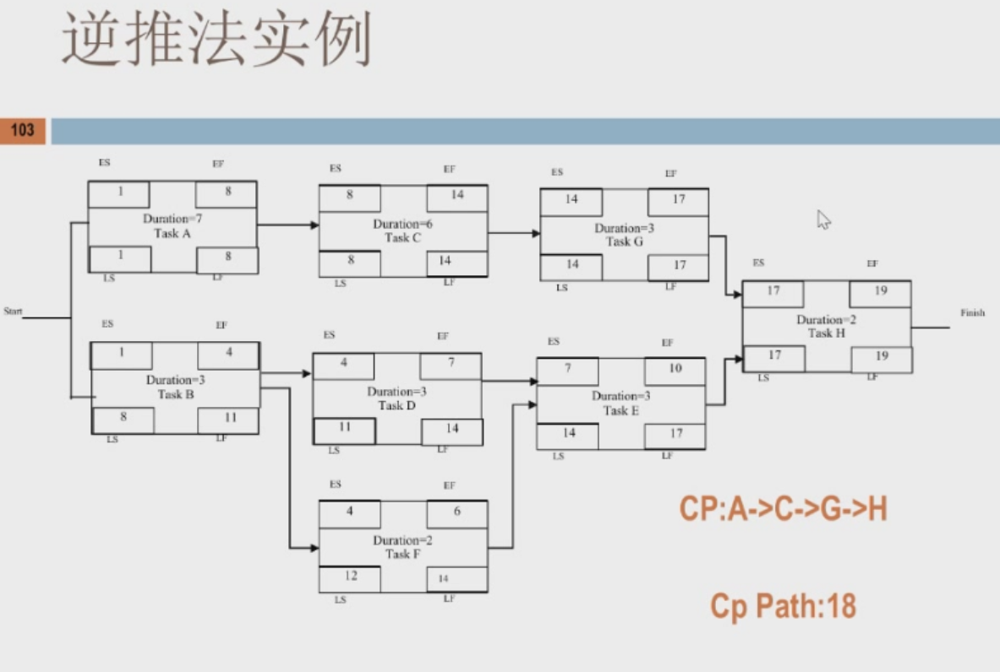

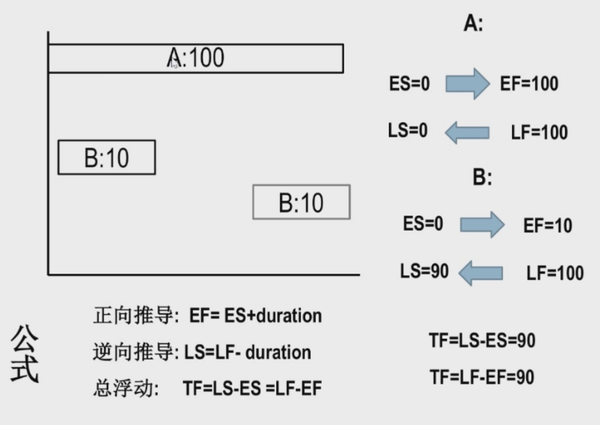

### 3. 缩短项目进度的技术 (Schedule Compression) —— **🌟常考概念辨析**

当项目经理发现关键路径过长时，通常采用以下两种技术来缩短进度（必须清楚二者的优缺点）：   

1. **赶工 (Crashing)**：   
   - **方法**：通过为关键路径上的活动**分配更多资源**（如加班、加派人手）来进行成本和进度的权衡。
   - **优缺点**：优点是能缩短完成时间；缺点是**通常会增加项目总成本 (incremental cost)**。
2. **快速跟进 (Fast tracking)**：   
   - **方法**：将原本按顺序执行的活动改为**并行执行 (in parallel)**。
   - **优缺点**：优点是能缩短时间；缺点是**会增加项目风险**，并可能导致返工 (rework) 从而反而延长进度或增加成本。

### 4. 关键链进度计划 (Critical Chain Scheduling)

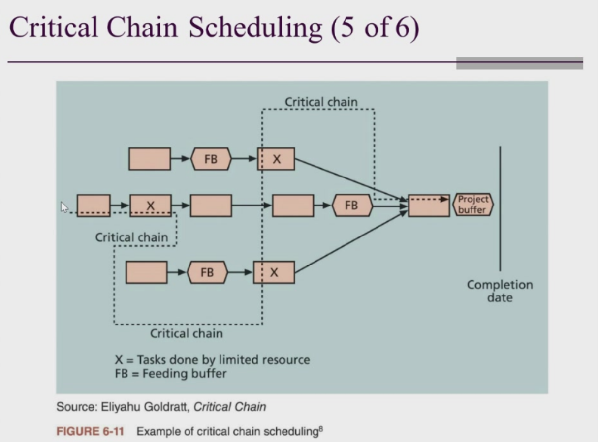

> - **X = 由有限资源完成的任务（Tasks done by limited resource）**：图中标有X的方块代表需要用到同一个稀缺资源（比如某台特殊设备、某个特定专家）的任务。因为资源有限，这些任务不能同时进行，必须排队，这就形成了一条最长的路径，即**关键链（图中的虚线框）**。
> - **FB = 汇入缓冲（Feeding buffer）**：你会看到，有些不在关键链上的分支任务（非关键路径），在汇入关键链之前，会加上一个FB。它的作用是吸收这些非关键任务可能产生的延误，**保护关键链上的任务不被拖累**。
> - **Project buffer（项目缓冲）**：在整条关键链的最后，也就是项目完成日期之前，放了一个大缓冲。这是为了保护整个项目不延期。

- **理论基础**：基于约束理论 (Theory of Constraints, TOC)，考虑在创建进度计划时的**资源限制 (limited resources)**，并引入缓冲 (buffers) 来保护项目完成日期。   
- **核心痛点：多任务处理 (Multitasking)**：资源同时处理多个任务通常是不好的，会导致完成时间延后，并浪费设置时间 (setup time)。关键链要求尽量减少多任务处理。   
- 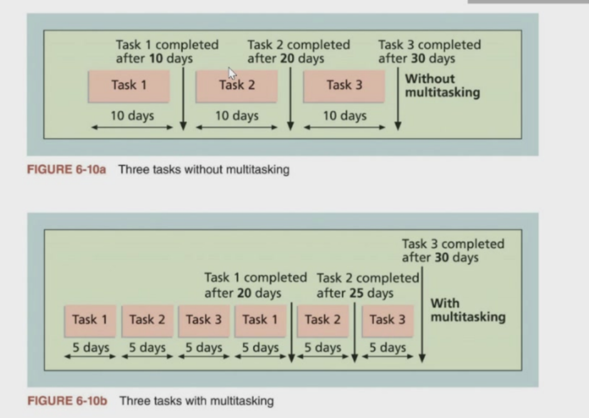
- **缓冲机制 (Buffers)**（避免帕金森定律：工作会膨胀以填满分配的时间）：   
- > - **传统估算的弊端**：人们在做任务时间估算时，通常会加入大量的“安全时间/缓冲（Safety or buffer）”，以防万一。这是因为**墨菲定律（Murphy's Law）：凡是可能出错的事，就一定会出错。** 大家都怕担责，所以拼命往宽了报。
  > - **关键链的做法**：
  >   1. **去除个人任务的缓冲（Remove buffers from individual tasks）**：要求大家给出最真实、最紧凑的预估时间，不能自己藏私房钱（安全时间）。
  >   2. **集中建立项目缓冲（Project buffer）**：把大家交出来的“安全时间”汇总起来，放在整个项目的最后面。
  >   3. **设立汇入缓冲（Feeding buffers）**：把缓冲放在非关键路径汇入关键链的交汇点，防止支线任务的延误影响主线（即保护关键链上的任务不被延误）。
  
  - **项目缓冲 (Project buffer)**：添加在项目截止日期之前，保护整个项目。   
  - **接驳缓冲 (Feeding buffers)**：添加在关键链上的任务之前，如果这些任务由非关键路径上的任务前置，则用来保护关键链免受延误影响。   
  - *区别于传统估算*：传统估算大家习惯在每个任务里加水分（墨菲定律）；关键链去除了单个任务的缓冲，集中设置为项目和接驳缓冲。   
  
  > 关键链法的优势，以及它为什么能解决传统管理的顽疾。
  >
  > - **任务估算更短**：因为单个任务里没有水分（缓冲）了，所以估算时间比传统方式短得多。
  > - **克服“帕金森定律（Parkinson's Law）”**：PPT中高亮了一句经典名言：**“工作总是会膨胀，直到占满所有可用的时间。”** （Work expands to fill the time allowed）。如果给你5天，你就会摸鱼到第5天；如果去掉个人任务的缓冲，大家就没有机会拖延了。
  > - **保护真正的底线**：传统的做法是保护每一个任务的截止日期，但由于人性（拖延）和意外（墨菲定律），任务往往还是延期。关键链法放弃了保护每个小任务，转而用缓冲来保护**“项目真正的完成日期（Project completion date）”**。
  > - **高度评价**：PPT最后指出，关键链法是一个“复杂但强大”的工具。它结合了关键路径分析、资源约束和缓冲管理，被一些人认为是**项目管理领域最重要的新概念之一**。

### 补充：资源优化

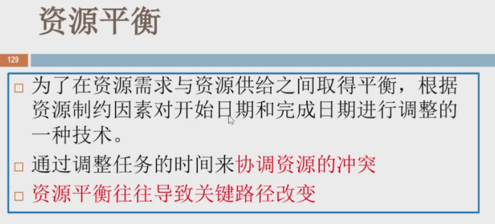

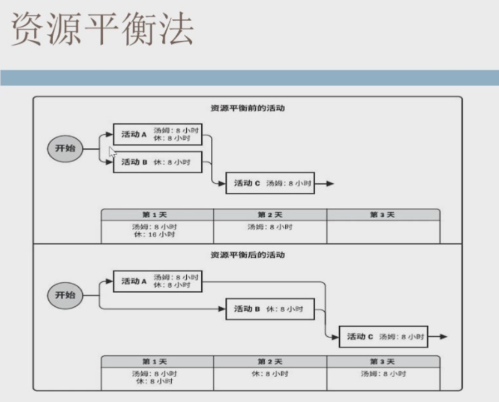

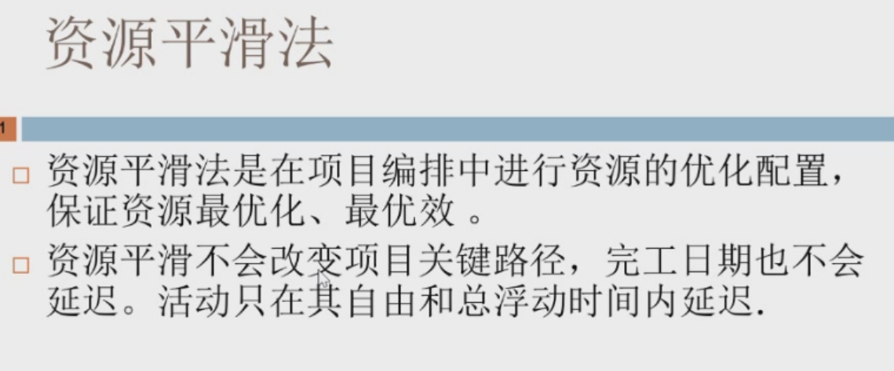

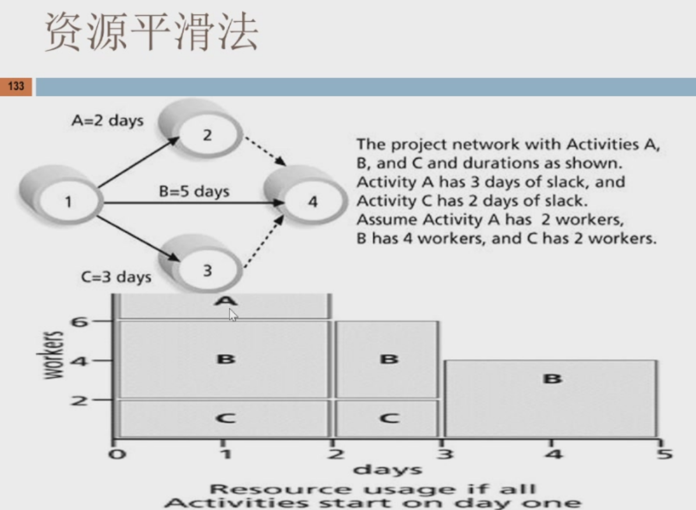

### 5. 计划评审技术 (PERT) —— **🌟必考计算公式**

- **适用场景**：当个体活动持续时间估算存在**高度不确定性 (high degree of uncertainty)** 时，用于估算项目持续时间。   

- **估算方法 (三点估算法)**：不使用单一的特定估算值，而是基于乐观 (Optimistic)、最可能 (Most likely) 和悲观 (Pessimistic) 的时间估算。   

- **加权平均公式 (Weighted Average Formula)**（考试一定会要求计算）：   

  $$加权平均值 = \frac{乐观时间 + 4 \times 最可能时间 + 悲观时间}{6}$$

  *计算提示：算出每个活动的加权平均值后，将其作为活动的持续时间，再去画网络图并找出关键路径*。  
  
  
  
  > 补充：
  >
  > 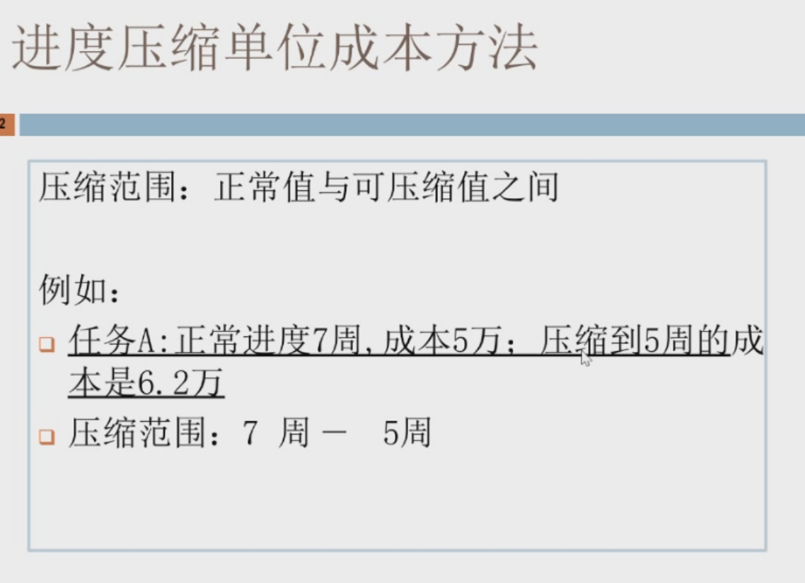
  >
  > 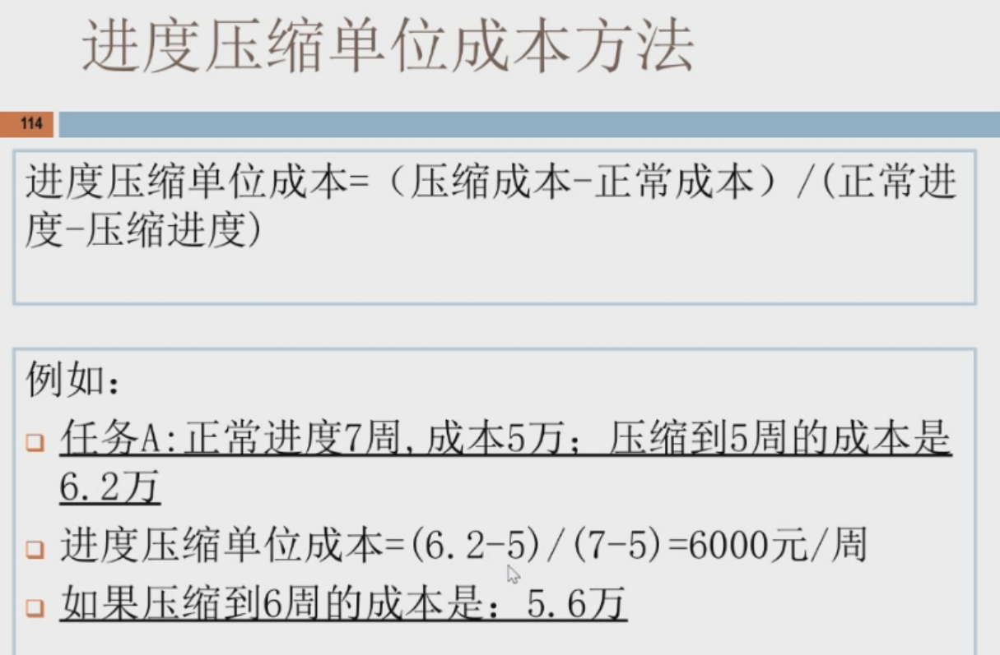 
  >
  > 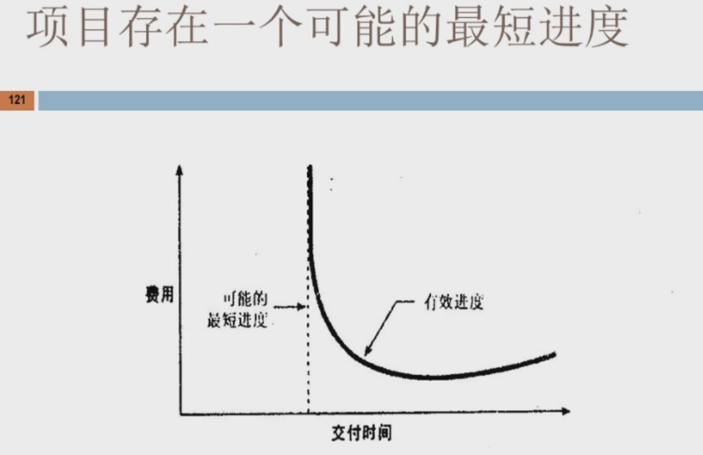

## 四、 过程 6：控制进度 (Controlling the Schedule)

- **目标**：了解进度状态，影响导致进度变化的因素，确定进度已经改变，并在变化发生时管理变化。   
- **人事问题是核心**：“大多数项目失败是因为人的问题，而不是因为没画好 PERT 图。”。项目经理需要极强的软技能（如与团队建立良好关系、发生严重冲突时及时警告高层管理人员等）来保证进度受控。   

## 五、 使用软件辅助项目进度管理 (Using Software to Assist)

- **作用**：像 Microsoft Project 这样的软件可以自动生成网络图、计算关键路径、计算浮动时间、生成甘特图以及进行“假设 (what if)”分析。   
- **警告 (Caution)**：   
  - 盲目使用软件是危险的。用户必须理解**底层的核心概念**（如如何创建网络图、如何寻找关键路径）。   
  - 不要过度依赖模板 (templates)。虽然模板可以节省设置时间，但模板中的很多假设可能并不适用于你的特定项目。   

**💡 考前冲刺建议：**

1. **熟记 PERT 估算公式**：$\frac{O + 4M + P}{6}$，注意 $M$（最可能时间）的权重是 4。   
2. **辨析赶工 (Crashing) vs. 快速跟进 (Fast Tracking)**：牢记“赶工=加钱加人”，“快速跟进=并行做，高风险”。   
3. **理解总浮动时间 (Total Slack) 和 自由浮动时间 (Free Slack) 的定义区别**。   
4. **明确关键路径的定义**：最长路径，决定最短完成时间。   