你好！针对你提供的《软件项目管理》课件（基于经典教材 Kathy Schwalbe 的 *Information Technology Project Management* 第7章及 PMBOK 第6版），我为你整理了一份**超详细、面向期末考试的深度复习讲义**。   

在软件项目管理期末考试中，**项目成本管理（Project Cost Management）\**是绝对的核心章节，通常会以\**名词解释、选择题、简答题**以及**重头戏——挣值管理（EVM）计算大题**的形式出现。本讲义不仅完整覆盖了课件中的所有知识点，还对课件中留白的计算表格（如 Table 7-3）进行了完整推导，并补充了易混概念对比与实战例题。

# 《软件项目管理》期末核心复习讲义：项目成本管理 (Project Cost Management)

## 模块一：项目成本管理导论与重要性

### 1.1 基本定义

- **成本 (Cost)**：为实现特定目标而牺牲或放弃的资源（A resource sacrificed or foregone to achieve a specific objective），或为换取商品与服务而放弃的东西。通常用货币金额（如美元、人民币）来衡量。   
- **成本超支 (Cost Overrun)**：实际成本超过估算成本的额外百分比或货币金额。   
- **项目成本管理 (Project Cost Management)**：包含确保项目在批准的预算内（within an approved budget）完成所需的一系列过程。   
  - **项目经理的职责**：必须确保项目 1) 定义明确；2) 具有准确的进度和成本估算；3) 拥有自己参与审批且切实可行的预算。同时，要在满足利益相关者需求的同时，持续努力降低和控制成本。   

### 1.2 为什么 IT 项目成本管理极其重要？（背景与案例）

- **IT 项目记录不佳**：IT 项目在达成预算目标方面的历史表现非常糟糕。   
- **哈佛商业评论（HBR 2011）研究数据**：
  - 分析了近 1,500 个 IT 变革项目，发现**平均成本超支率为 27%**。   
  - **黑天鹅事件 (Black Swan)**：指罕见且不可预测、但在事后看来并非不可能发生的高影响事件。研究发现 **1/6** 的 IT 项目包含“黑天鹅”，这类项目的**平均成本超支高达 200%**，**进度超支接近 70%**！   
- **经典失败案例：英国国家医疗服务体系（NHS）IT 现代化项目**：
  - 被称为“历史上最大的 IT 灾难”。该项目始于 2002 年（原计划 10 年），旨在建立电子病历、预约和处方药系统。   
  - **结果**：预计最终耗资超 550 亿美元（**超支 260 亿美元**），最终于 2011 年被废弃。   
  - **失败原因（简答题常考）**：系统不兼容导致的技术问题、医生的抵触情绪、承包商之间关于责任划分的争执。   

## 模块二：项目成本管理的四大核心过程（框架必背）

> **💡 考点提示**：考试常考“哪几个过程属于哪个过程组”以及“每个过程的核心输出（Main Outputs）是什么”。

| **序号** | **过程名称 (Process)**                       | **所属过程组 (Process Group)**          | **核心定义与作用**                                           | **主要输出 (Main Outputs)**                                  |
| -------- | -------------------------------------------- | --------------------------------------- | ------------------------------------------------------------ | ------------------------------------------------------------ |
| **1**    | **规划成本管理**  (Planning cost management) | 规划过程组 (Planning)                   | 确定用于规划、执行和控制项目成本的政策、程序和文档。         | • **成本管理计划** (Cost management plan)                    |
| **2**    | **估算成本**  (Estimating costs)             | 规划过程组 (Planning)                   | 对完成项目所需资源的成本进行近似估算。                       | • **活动成本估算** (Activity cost estimates)  • **估算依据** (Basis of estimates)  • 项目文件更新 (Project documents updates) |
| **3**    | **制定预算**  (Determining the budget)       | 规划过程组 (Planning)                   | 将整体成本估算分配到各个单项工作（WBS工作项）中，以建立用于衡量绩效的基准。 | • **成本基准** (Cost baseline)  • **项目资金需求** (Project funding requirements)  • 项目文件更新 (Project documents updates) |
| **4**    | **控制成本**  (Controlling costs)            | 监控过程组 (Monitoring and Controlling) | 控制对项目预算的变更。                                       | • **工作绩效信息** (Work performance information)  • **成本预测** (Cost forecasts)  • **变更请求** (Change requests)  • 项目管理计划更新、项目文件更新、组织过程资产更新 |

## 模块三：成本管理的基本原理与财务概念（名词解释/选择题高频）

IT 项目经理必须能够用**财务术语**和**技术术语**汇报工作，因为高管董事会更关心财务指标。许多 IT 项目未能立项是因为技术人员不会做财务论证。   

### 3.1 基础财务指标

1. **利润 (Profits)**：收入减去支出（Revenues minus expenditures）。增加利润的途径：增加收入、减少开支或双管齐下。   
2. **利润率 (Profit Margin)**：利润与收入的比率（Ratio of profits to revenues）。   
   - *补充举例*：如果项目带来 $100 万收入，成本花费 $80 万，则利润为 $20 万，利润率为 $20 / 100 = 20\%$。
3. **全生命周期成本法 (Life Cycle Costing)**：
   - **定义**：考虑项目的**总拥有成本（Total Cost of Ownership, TCO）**，即**开发成本 + 运维支持成本（Development plus support costs）**。   
   - **意义**：提供项目在整个生命周期内成本的全局视图，帮助准确预测财务成本和收益。组织往往容易犯“在项目早期阶段投入资金不足”的错误，导致后期维护成本飙升，严重影响总拥有成本。   
4. **现金流分析 (Cash Flow Analysis)**：【重点】
   - **定义**：确定项目预计年度成本和收益，以及由此产生的年度现金流的方法。   
   - **意义**：项目经理必须进行现金流分析以确定**净现值 (NPV)**，并在选择项目时考虑现金流状况。   

### 3.2 成本与收益的分类（两对重要对比 + 沉没成本）

1. **有形成本/收益 vs. 无形成本/收益**：
   - **有形成本/收益 (Tangible costs/benefits)**：容易用货币（美元）衡量的部分。*（例：购买服务器的费用、外包人力成本、直接销售收入）*   
   - **无形成本/收益 (Intangible costs/benefits)**：难以用货币衡量的部分（因此往往更难证明其合理性），例如商誉（goodwill）、员工士气（employee morale）、品牌形象等。   
2. **直接成本 vs. 间接成本**：
   - **直接成本 (Direct costs)**：与创造项目产品和服务**直接相关**的成本（例如：项目专职人员的薪水、项目专用软硬件采购费）。**项目经理应重点关注直接成本，因为它们是可控的**。   
   - **间接成本 (Indirect costs)**：与项目产品或服务**不直接相关**，但与开展项目工作间接相关的成本，如水电费（electricity）、办公场地租金、行政管理分摊等。   
3. **沉没成本 (Sunk Cost)**【必考选择题】：
   - **定义**：过去已经花掉的钱（Money that has been spent in the past）。   
   - **决策原则**：在决定投资或继续哪些项目时，**绝不应将沉没成本考虑在内（Should NOT include sunk costs）**，应当视其已经消失。   
   - *补充举例*：某软件项目已投入 500 万，现发现市场需求消失，继续开发还需 200 万但只能收回 100 万。此时绝不能因为“已经投了 500 万不甘心”而继续，那 500 万就是沉没成本。

### 3.3 学习曲线理论与储备金

1. **学习曲线理论 (Learning Curve Theory)**：
   - **定义**：当许多物品被重复生产时，随着生产数量的增加，这些物品的**单位成本（unit cost）会以有规律的模式下降**。   
   - *软件工程应用*：团队第一次用某新框架开发模块可能需要 100 小时，但开发到第 10 个类似模块时，由于熟练度提升，可能只需 30 小时。
2. **储备金 (Reserves)**【极高频考点：应急储备 vs. 管理储备】：
   - **定义**：包含在成本估算中、通过为难以预测的未来情况留出余地，从而**减轻成本风险**的资金。   

| **对比维度**         | **应急储备 (Contingency Reserves)**                        | **管理储备 (Management Reserves)**                           |
| -------------------- | ---------------------------------------------------------- | ------------------------------------------------------------ |
| **针对的风险类型**   | **已知—未知风险 (Known unknowns)**  可以部分规划的未来情况 | **未知—未知风险 (Unknown unknowns)**  完全无法预测的未来情况 |
| **是否计入成本基准** | **是 (Included in cost baseline)**                         | **否 (NOT included in cost baseline)**  但包含在**项目总预算 (Project Budget)** 中 |
| **课件典型例子**     | 为替换离职团队成员而产生的招聘和培训成本                   | 替换突然生病的项目经理所需的成本                             |

## 模块四：详解四大过程之（1）规划成本管理 (Planning Cost Management)

- **核心任务**：规划在整个项目生命周期中如何管理成本。它源于启动项目的基础文件（如项目章程 Project Charter）。   
- **工具与技术**：专家判断 (Expert judgment)、分析技术 (Analytical techniques)、会议 (Meetings)。   
- **核心输出——《成本管理计划》(Cost Management Plan) 包含的 7 大内容**：
  1. **精确度等级 (Level of accuracy)**：活动成本估算的舍入指南（如四舍五入到最接近的 $100），以及包含应急资金的指南（如 10% 或 20%）。   
  2. **计量单位 (Units of measure)**：定义成本测量中使用的每种单位，如工时（labor hours）、工日（days）等。   
  3. **组织程序链接 (Organizational procedure links)**：许多组织将用于项目成本核算的 WBS 组件称为**控制账户 (Control Account, CA)**。每个 CA 在组织的会计系统中通常分配有唯一的代码，团队必须正确理解和使用这些代码。   
  4. **控制临界值 (Control thresholds)**：在需要采取行动之前允许的成本偏差量，例如基准成本的 $\pm 10\%$。   
  5. **绩效测量规则 (Rules of performance measurement)**：如果项目使用挣值管理 (EVM)，需定义测量规则，如跟踪实际成本的频率和详细程度。   
  6. **报告格式 (Reporting formats)**：成本报告的格式和提交频率。   
  7. **过程描述 (Process descriptions)**：如何执行所有成本管理过程的说明。   

## 模块五：详解四大过程之（2）估算成本 (Estimating Costs)

在制定了良好的资源需求清单后（例如：执行测试需要什么技能水平的人、多少人、多少小时），项目经理和团队必须对这些资源的成本进行估算。   

### 5.1 成本估算的三种基本类型（必背表格）

随着项目推进，估算会分阶段进行，且准确度应越来越高。   

| **估算类型 (Type of Estimate)**                          | **别名 / 特点**                                        | **何时进行 (When Done)**                                     | **为什么做 / 用途 (Why Done)**                            | **典型准确度范围 (Typical Range)** |
| -------------------------------------------------------- | ------------------------------------------------------ | ------------------------------------------------------------ | --------------------------------------------------------- | ---------------------------------- |
| **1. 粗略量级估算**  **(ROM: Rough Order of Magnitude)** | 又称 ballpark estimate, guesstimate, swag, broad gauge | 项目生命周期非常早期，甚至在项目正式启动前（通常在完成前 **3~5 年**） | 为**项目选择决策 (selection decisions)** 提供成本估算     | **-50% 到 +100%**                  |
| **2. 预算估算**  **(Budgetary estimate)**                | 中期估算                                               | 较早阶段，项目完成前 **1~2 年**                              | 将资金纳入公司的**预算计划 (budget plans)**               | **-10% 到 +25%**                   |
| **3. 确定性估算**  **(Definitive estimate)**             | 三者中最准确的估算                                     | 项目后期，距离项目完成 **1 年以内（或更短）**                | 为**采购决策 (purchases)** 提供细节，估算最终实际项目成本 | **-5% 到 +10%**                    |

- **补充概念**：
  - **估算依据 (Supporting details / Basis of estimates)**：包括制定估算时使用的基本规则和假设（ground rules and assumptions）、作为估算基础的项目描述、使用的成本估算工具和技术细节。这有助于日后更新估算。   
  - **全职等效工时 (FTE: Full-Time Equivalent)**：由于人工成本占总成本很大比例，组织常按部门或技能估算所需人数。FTE 是指代项目所需总人员配置的标准方式，无论人员是全职还是兼职工作（例如 2 个半职人员 = 1 个 FTE）。   
  - 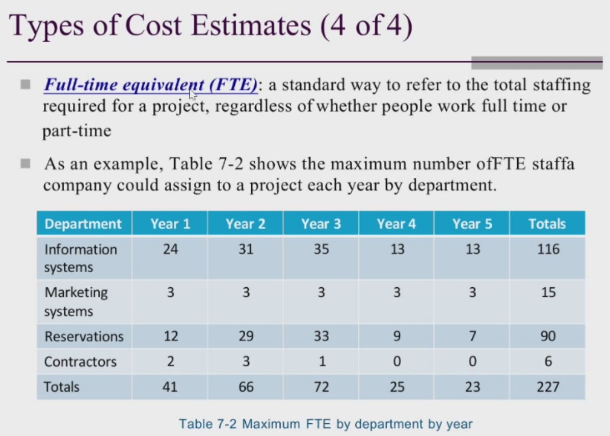

### 5.2 成本估算的四大工具与技术（简答/应用高频）

实践中，结合使用以下多种技术通常能提供最佳的成本估算：   

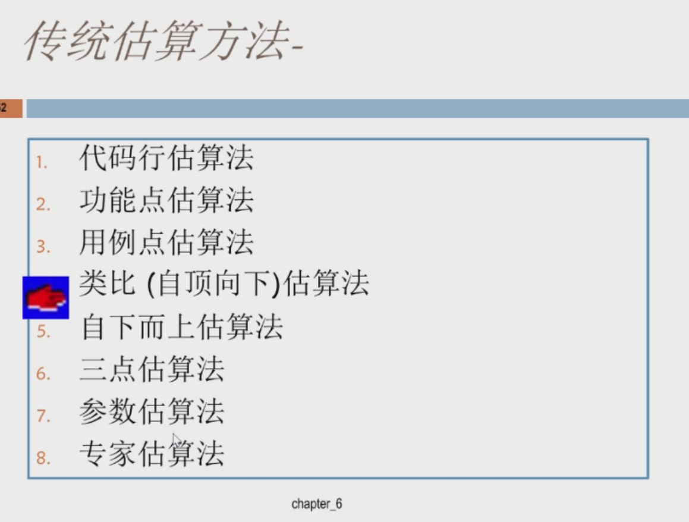

1. **类比估算 / 自上而下估算 (Analogous or Top-down estimates)**：
   - **原理**：使用**以往类似项目的实际成本**作为估算当前项目成本的基础。   
   - **优缺点与适用条件**：需要大量的专家判断；比其他技术**成本更低、耗时更少，但准确度也较低**。当以往项目在**实质上（in fact）而不仅仅是表面上（in appearance）相似**时最为可靠。   
2. **自下而上估算 / 作业成本法 (Bottom-up estimates / Activity-based costing)**：
   - **原理**：估算单个工作项或活动（individual work items or activities）的成本，然后将它们汇总（summing them）以获得项目总成本。   
   - **优缺点**：单个工作项的大小和估算人员的经验决定了估算的准确性。通常**非常耗时且开发成本高昂（time-intensive and expensive）**，但准确度高。   
3. **三点估算 (Three-point estimates)**：
   - **原理**：估算项目各项的**最可能成本 (Most likely, $c_m$)**、**最乐观成本 (Optimistic, $c_o$)** 和**最悲观成本 (Pessimistic, $c_p$)**。   
   - **方法**：可以使用第 4 讲介绍的 **PERT 加权平均公式**（补充公式：$E = \frac{c_o + 4c_m + c_p}{6}$）或**蒙特卡洛模拟 (Monte Carlo simulation)** 来计算。   
4. **参数估算 (Parametric estimating)**：
   - **原理**：在**数学模型**中使用项目特征（参数 parameters）来估算项目成本。   
   - **可靠条件**：用于创建模型的历史信息准确、参数易于量化、模型在项目规模方面具有灵活性。   
   - **例子**：建筑工程按“每平方英尺成本”估算；软件工程（如课件案例 Figure 7-3）按“每功能点工时/成本 (Function Point)”**或**“每千行代码成本 (KSLOC)”进行数学建模估算。   
   
   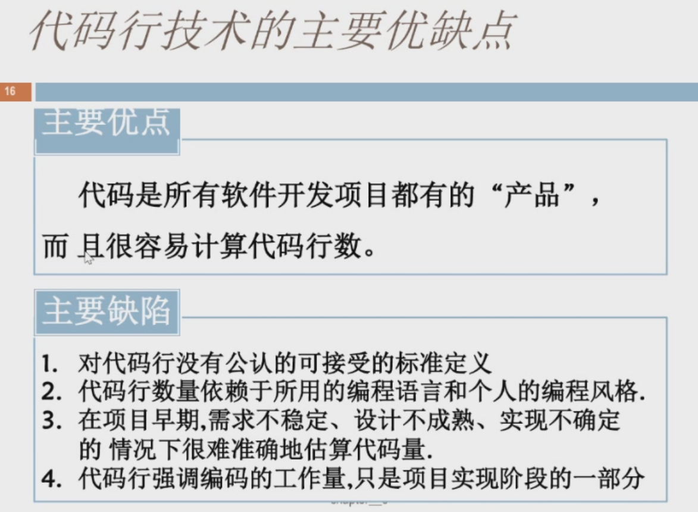
   
   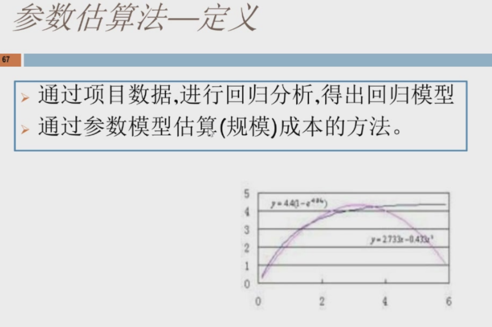
   
   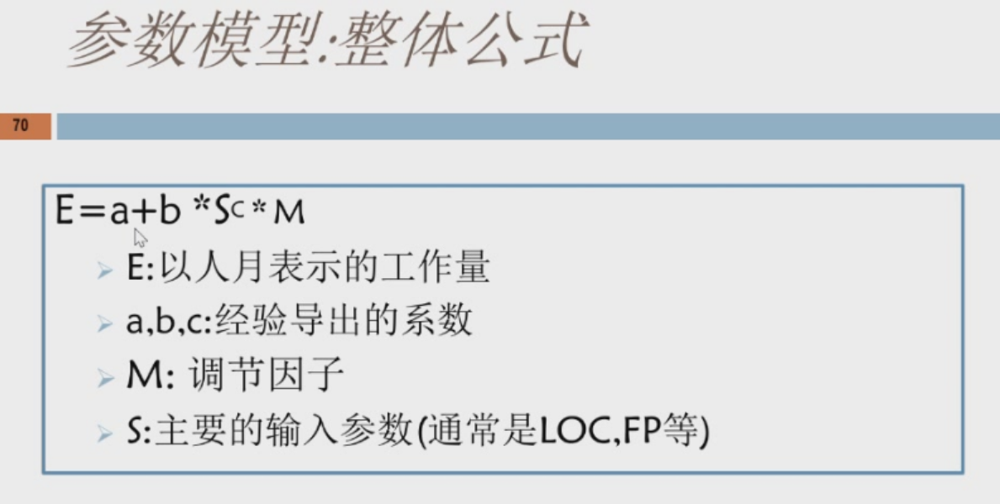
   
   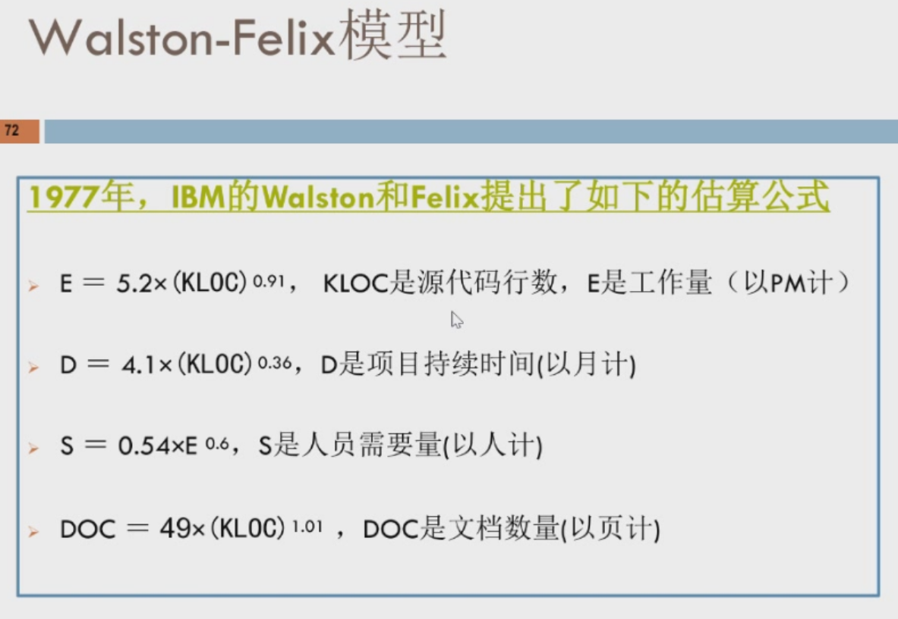
   
   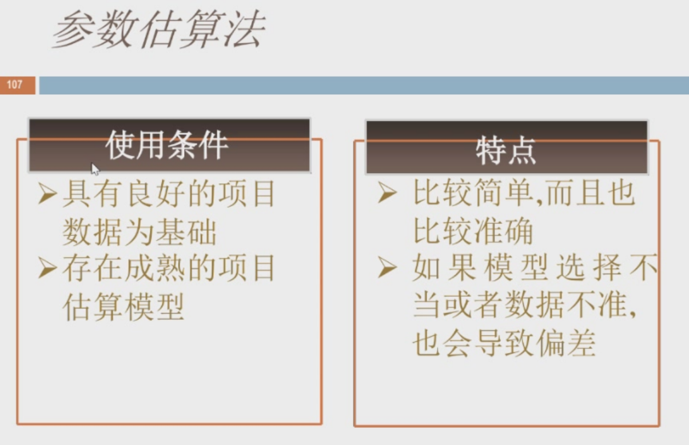
   
   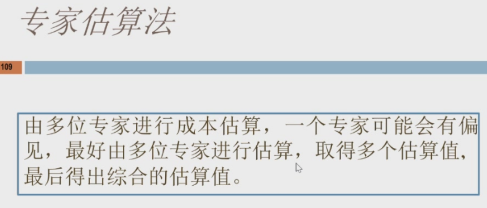
   
   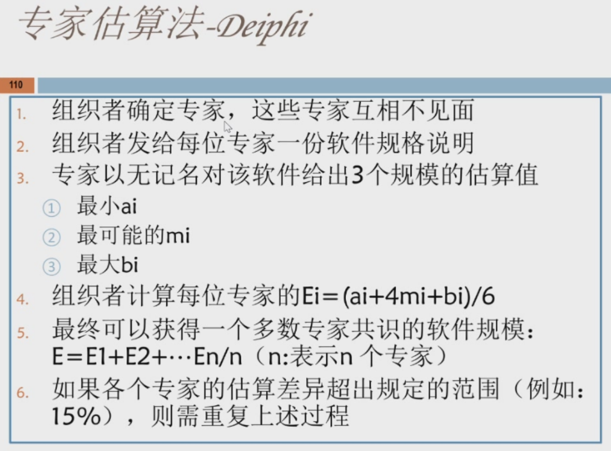
   
   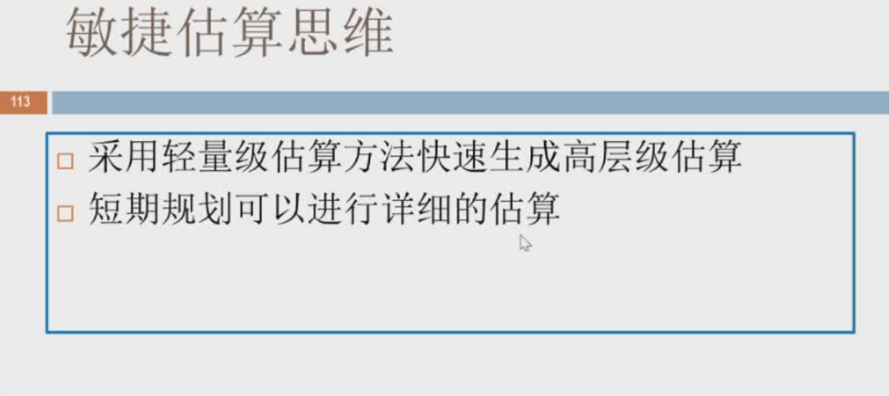
   
   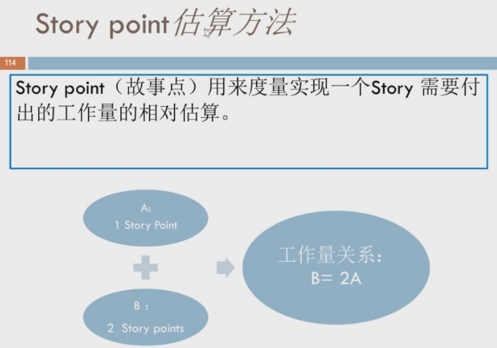

### 5.3 IT 成本估算不准确的四大典型原因（简答题必背）

1. **估算做得太仓促 (Estimates are done too quickly)**：大型软件估算很复杂，但很多估算被迫在系统需求尚未明确之前就匆忙完成。   
2. **人员缺乏估算经验 (People lack estimating experience)**：软件估算人员往往缺乏成本估算经验，尤其是大型项目的经验。   
3. **人类天生倾向于低估 (Human beings are biased toward underestimation)**：人们往往过度乐观（例如忽视集成和测试的复杂性），因此项目经理和高管必须审查估算并提出关键问题以消除偏差。   
4. **管理层渴望得到一个“准确（往往是偏低）”的数字 (Management desires accuracy)**：管理层索要估算时，实际上可能想要一个具体的数字来帮助他们竞标赢下大合同或获取内部资金。项目经理必须坚持良好的估算，并运用领导力和谈判技巧捍卫这些估算。   

> **⚠️ 重要警示**：高管永远不会忘记你的第一次估算，却几乎从不记得已批准的变更是如何影响估算的！因此，持续且正式地向高管通报修订后的成本估算至关重要。   

### 5.4 成本估算实战案例解析（Surveyor Pro 项目，课件 P23-25）

- **估算前准备**：收集项目详细信息，询问组织打算如何使用该估算，明确基本规则和假设（ground rules and assumptions），审查项目进度计划草案（因为估算需按 WBS 和月份提供），并让多人评审估算结果。   
- **课件 Figure 7-2 & 7-3 关键计算逻辑（可能会出小计算题）**：
  - **比例关联法**：如测试成本按“软硬件总成本的 10%”估算（硬件 $76,000 + 软件 $614,000 = $690,000，测试 = $69,000）；应急储备按“小计估算总额的 20%”计算（$1,267,700 × 20% = $253,540）。   
  - **功能点估算法 (Function Point Estimate, Figure 7-3)**：   
    1. 将外部输入(10×4=40)、外部接口文件(3×7=21)、外部输出(4×5=20)、外部查询(6×4=24)、逻辑内部表(7×10=70)乘以各自的转换因子并求和，得到**总功能点数 = 175 FP**。   
    2. 结合历史数据（27 小时/功能点），计算总工时 = $175 \times 27 = 4,725$ 小时。   
    3. 乘以每小时人工成本（$120/小时），得出功能点估算总成本 = $4,725 \times \$120 = \$567,000$（与人工工时估算的 $594,000 相互印证）。   

## 模块六：详解四大过程之（3）制定预算 (Determining the Budget)

### 6.1 核心概念与流程

- **定义**：基于项目的 WBS 活动，将项目成本估算按时间跨度（over time）分配给各个物质资源或工作项。   
- **两大主要目标**：
  1. 产生用于衡量项目绩效的**成本基准 (Cost baseline)**。   
  2. 确定**项目资金需求 (Project funding requirements)**（有些项目启动时资金全部到位，有些则依赖定期拨款以避免现金流问题）。   
- **成本基准 (Cost Baseline)**：项目经理用来衡量和监控成本绩效的**按时间分段分配的预算（time-phased budget）**（如课件 Figure 7-4 按第 1~12 个月展开的表格）。**它包含应急储备，但不包含管理储备**。   

### 6.2 项目预算的层级构成（PMBOK Figure 7-5 必考逻辑关系）

从下至上层层汇总的逻辑关系如下：   

1. **活动成本估算 (Activity Cost Estimates)** + **活动应急储备 (Activity Contingency Reserve)** = **工作包成本估算 (Work Package Cost Estimates)**

      

2. **工作包成本估算** + **应急储备 (Contingency Reserve)** = **控制账户 (Control Accounts)** $\longrightarrow$ 汇总形成 **成本基准 (Cost Baseline)**

      

3. **成本基准 (Cost Baseline)** + **管理储备 (Management Reserve)** = **项目总预算 (Project Budget)**

      

### 6.3 预算类别 (Budget Categories)

在制定估算前了解组织的预算类别（如每月 FTE 员工成本、采购商品和服务、租金、差旅、其他耗材费用）非常重要。组织利用这些信息跨项目跟踪成本、寻找降本途径，并将其用于**法律和税务目的（legal and tax purposes）**。   

## 模块七：详解四大过程之（4）控制成本与挣值管理 (EVM)【计算大题绝对核心】

### 7.1 控制成本的职责与工具

- **职责**：1) 监控成本绩效；2) 确保只有适当的项目变更才被纳入修订后的成本基准中；3) 向项目利益相关者通报将影响成本的已批准变更。   
- **工具与技术**：专家判断、数据分析、项目管理信息系统 (PMIS)、**挣值管理 (Earned Value Management, EVM)**。   

### 7.2 挣值管理 (EVM) 基础与三大基本参数

> 要考大题20分

- **定义**：EVM 是一种综合了**范围 (Scope)、时间/进度 (Time) 和成本 (Cost)** 数据的项目绩效测量技术。通过将实际信息与基准进行比较来评估项目达标情况。   
- **三大基础值（针对 WBS 中的每个活动或汇总活动计算）**：
  1. **计划价值 (PV, Planned Value)**：分配给计划工作的经批准的预算（即：按计划到当前时间点**应该**完成多少预算的工作）。   
  2. **实际成本 (AC, Actual Cost)**：在特定时间内完成某项活动的工作所产生的实际总成本（即：到当前时间点**实际花了**多少钱）。   
  3. **挣值 (EV, Earned Value)**：对已完成工作的测量，用分配给该工作的批准预算来表示（即：**实际干完的活**，按原本预算值多少钱）。   
     - **计算公式**：$EV = \text{已完成工作的 } PV \text{ 总和}$ （或：$EV = PV \times \text{实际完成百分比 RP}$）。   

### 7.3 EVM 核心派生指标与公式汇总表（必须滚瓜烂熟！）

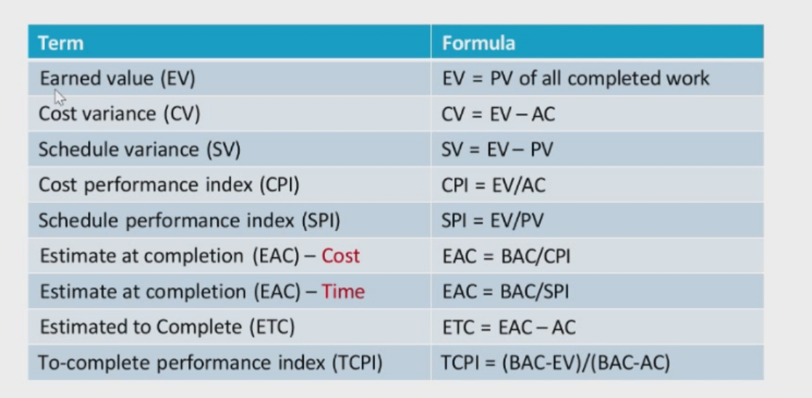

| **指标名称**         | **英文缩写**                              | **计算公式 (Formula)**               | **指标含义与绩效判断标准（极其重要！）**                     |
| -------------------- | ----------------------------------------- | ------------------------------------ | ------------------------------------------------------------ |
| **成本偏差**         | **CV**  (Cost Variance)                   | $$CV = EV - AC$$                     | • **$CV < 0$（负数）**：成本超支 (Over budget)，有问题     • **$CV = 0$**：符合预算  • **$CV > 0$（正数）**：成本节约 (Under budget) |
| **进度偏差**         | **SV**  (Schedule Variance)               | $$SV = EV - PV$$                     | • **$SV < 0$（负数）**：进度落后 (Behind schedule)，有问题     • **$SV = 0$**：符合进度  • **$SV > 0$（正数）**：进度超前 (Ahead of schedule) |
| **成本绩效指数**     | **CPI**  (Cost Performance Index)         | $$CPI = \frac{EV}{AC}$$              | • **$CPI < 1$**：成本超支（每花 $1 换回的价值不足 $1）     • **$CPI = 1$**：符合预算  • **$CPI > 1$**：成本表现良好（节约） |
| **进度绩效指数**     | **SPI**  (Schedule Performance Index)     | $$SPI = \frac{EV}{PV}$$              | • **$SPI < 1$**：进度落后（实际完成工作量少于计划）     • **$SPI = 1$**：符合进度  • **$SPI > 1$**：进度超前 |
| **完工预算**         | **BAC**  (Budget at Completion)           | 项目原本的总预算（或总计划工期）     | 整个项目的总基准成本（或总计划时间）。                       |
| **完工估算（成本）** | **EAC (Cost)**  (Estimate at Completion)  | $$EAC = \frac{BAC}{CPI}$$            | 按当前成本效率，预计整个项目全部完成时**总共需要花多少钱**。若 $EAC > BAC$，说明预计总成本超支。 |
| **完工估算（时间）** | **EAC (Time)**  (Estimate at Completion)  | $$EAC = \frac{BAC}{SPI}$$            | 按当前进度效率，预计整个项目全部完成时**总共需要多少时间**。 |
| **完工尚需估算**     | **ETC**  (Estimated to Complete)          | $$ETC = EAC - AC$$                   | 从当前时间点开始，把剩下的活干完**还需要再花多少钱**。       |
| **完工尚需绩效指数** | **TCPI**  (To-Complete Performance Index) | $$TCPI = \frac{BAC - EV}{BAC - AC}$$ | 为了在原定总预算 (BAC) 内完成项目，**剩余工作必须达到的成本绩效指数**（剩余工作量 / 剩余预算）。若 $TCPI > 1$，说明后续必须勒紧裤腰带提高效率才能不超支。 |

> **🧠 记忆口诀**：
>
> - **EV 永远在前面 / 在分子上**！无论是减法（$CV = EV - AC$, $SV = EV - PV$）还是除法（$CPI = EV / AC$, $SPI = EV / PV$），永远是 **EV** 打头阵！
> - **C 代表 Cost（和 AC 算），S 代表 Schedule（和 PV 算）**！

### 7.4 课件留白例题完整精讲（Table 7-3，课件 P34）

课件第 34 页给出了一个经典例题，但表格是留空的（供上课板书填写）。这里为你把**完整计算过程与答案**补全，考试大概率直接考类似题型！

- **【题目背景】**： 假设某项目包含一项“采购并安装新 Web 服务器”的汇总活动。   
  - **基准计划 (Baseline)**：计划耗时 **1 周**完成，总预算成本（**BAC**）为 **$10,000**。   
  - **实际执行情况 (Actual performance)**：实际上花了 **2 周**才完成，总计花费 $20,000（其中：**第 1 周实际花费 $15,000**，第 2 周花费 $5,000）。（*注：由于总共用了 2 周完成，默认第 1 周结束时工作完成了一半，即完成率 $RP = 50\%$*）。   
- **【问题】**：请计算**第 1 周结束时 (After Week 1)** 的各项挣值指标。   
- **【完整解答步骤】**：

| **指标名称 (Activity)**    | **第 1 周末数值 (Week 1)** | **详细计算公式与推导说明**                                   |
| -------------------------- | -------------------------- | ------------------------------------------------------------ |
| **计划价值 (PV)**          | **$10,000**                | 原计划 1 周内全部干完，所以第 1 周末的计划价值就是全部预算 $10,000。 |
| **实际成本 (AC)**          | **$15,000**                | 题目明确给出：第 1 周实际产生了 $15,000 的费用。             |
| **挣值 (EV)**              | **$5,000**                 | 第 1 周只完成了 50% 的工作，因此 $EV = \$10,000 \times 50\% = \$5,000$。 |
| **成本偏差 (CV)**          | **-$10,000**               | $CV = EV - AC = \$5,000 - \$15,000 = -\$10,000$（严重超支）。 |
| **进度偏差 (SV)**          | **-$5,000**                | $SV = EV - PV = \$5,000 - \$10,000 = -\$5,000$（进度落后）。 |
| **成本绩效指数 (CPI)**     | **0.33** (或 33.3%)        | $CPI = \frac{EV}{AC} = \frac{\$5,000}{\$15,000} \approx 0.333$（效率极低）。 |
| **进度绩效指数 (SPI)**     | **0.50** (或 50%)          | $SPI = \frac{EV}{PV} = \frac{\$5,000}{\$10,000} = 0.50$（进度只有计划的一半）。 |
| **完工估算-成本 (EAC)**    | **$30,000**                | $EAC = \frac{BAC}{CPI} = \frac{\$10,000}{1/3} = \$30,000$（若按第1周效率，总成本预计达3万）。 |
| **完工尚需估算 (ETC)**     | **$15,000**                | $ETC = EAC - AC = \$30,000 - \$15,000 = \$15,000$（预计还需再花 1.5 万）。 |
| *(补充)* **完工估算-时间** | **2 周 (Weeks)**           | $EAC(\text{Time}) = \frac{\text{原计划总时间 } 1\text{ 周}}{SPI (0.5)} = 2\text{ 周}$。 |

### 7.5 挣值图表分析 (Earned Value Chart, 课件 Figure 7-6)

在考卷的看图分析题中（如课件 P35 的 1 年期项目在 5 个月后的挣值图）：   

1. **三条曲线的位置关系**：
   - 图中第 5 个月时，代表实际成本的绿色虚线（**AC**）在最上方（约 $50,000+），代表计划价值的红色实线（**PV**）在中间（约 $45,000），代表挣值的紫色粗虚线（**EV**）在最下方（约 $40,000）。   
   - **结论**：因为 $EV < AC$（$CV < 0$），说明**成本超支**；因为 $EV < PV$（$SV < 0$），说明**进度落后**。   
2. **EAC 点与 BAC 点的相对位置（必考看图结论）**：
   - 图右上角中，**EAC 点位于 BAC 点的上方且偏右（above and to the right of the BAC point）**。   
   - **含义**：“偏上”意味着项目预计总花费比计划更多（cost more，成本超支）；“偏右”意味着项目预计耗时比计划更长（take longer than planned，进度延误）！   
3. **EVM 的核心灵魂**：**估算是 EVM 的核心与灵魂（The heart and soul of EVM are estimates）**。组织在尝试使用 EVM 之前，必须先学会如何做出良好的估算。   

### 7.6 EVM 的全球应用现状 (Global Issues, PMI 2010 研究)

- **普及度**：全球广泛使用，在中东、南亚、加拿大和欧洲尤为流行。大多数国家要求在大型国防或政府项目（large defense or government projects）中强制使用 EVM（占比达 51.3%）。   
- **推广 EVM 的两大主要障碍 (Top barriers)**：**缺乏动力 (lack of motivation)** 和 **缺乏专业知识 (lack of expertise)**。   
- **最重要成功因素 (Success factors)**：高层管理支持、项目人员认同 (buy-in)、培训、组织文化与领导力、项目管理系统成熟度。   

## 模块八：项目组合管理与软件工具辅助

### 8.1 项目组合管理 (Project Portfolio Management, PPM)

许多组织将整套项目或投资作为一个相互关联的活动集合（即项目组合 portfolio）进行收集和控制。因为组织内许多项目可能存在重叠，且 IT 投资巨大、风险高，项目经理需要理解自己的项目如何融入组织全局。   

- **项目组合管理的五个层级（Five Levels，从低到高排序题考点）**：   
  1. **将所有项目放入一个数据库中** (Put all your projects in one database)。   
  2. **对数据库中的项目进行优先级排序** (Prioritize the projects in your database)。   
  3. **根据投资类型将项目划分为两到三个预算类别** (Divide your projects into two or three budgets based on type of investment)，例如：必需系统（required systems）、渐进式升级（incremental upgrades）和战略投资（strategic investments）。   
  4. **实现存储库自动化** (Automate the repository)。   
  5. **应用现代投资组合理论** (Apply modern portfolio theory)，包括将项目风险映射到曲线上的风险—回报工具。   

### 8.2 使用软件辅助项目成本管理

1. **常用工具类型**：
   - **电子表格 (Spreadsheets，如 Excel)**：用于资源规划、成本估算、成本预算和成本控制的常见工具。   
   - **项目管理软件 (PM Software，如 Microsoft Project)**：具有许多成本管理功能（包括 EVM）。   
   - **企业或项目组合管理软件 (Enterprise / PPM Tools)**：整合多个项目的信息以展示项目状态和健康度。例如辉瑞（Pfizer）和福特（Ford）使用 PPM 软件提高多项目透明度；Forrester 研究估计企业投资 PPM 工具可获得 250% 的投资回报率。   
2. **为什么许多 IT 项目经理不使用 PM 软件管理成本？（简答小考点）**
   - 一是因为他们**不知道**可以使用项目管理软件来管理成本；   
   - 二是因为他们**没有基于 WBS 来跟踪成本**（而大多数项目管理软件都是基于 WBS 来核算成本的）。   

## 模块九：期末模拟自测题（含答案解析）

为了帮你检验复习效果，我根据这套课件设计了 3 道最具代表性的期末考题：

### 题目 1：辨析简答题

**问：请解释什么是“应急储备 (Contingency Reserves)”和“管理储备 (Management Reserves)”？它们在应对风险类型以及与“成本基准 (Cost Baseline)”和“项目总预算 (Project Budget)”的关系上有何区别？**

> **【参考答案】**：
>
> 1. **定义与风险类型**：两者都是包含在成本估算中以减轻未来难以预测的成本风险的资金。**应急储备**用于应对可以部分规划的未来情况，即“已知—未知风险 (Known unknowns)”，例如替补离职员工的招聘培训费；**管理储备**用于应对完全不可预测的未来情况，即“未知—未知风险 (Unknown unknowns)”，例如更换突发重病的项目经理的费用。   
> 2. **与基准和预算的关系**：**应急储备包含在成本基准 (Cost Baseline) 中**；而**管理储备不包含在成本基准中**，但它是**项目总预算 (Project Budget)** 的一部分（即：项目总预算 = 成本基准 + 管理储备）。   

### 题目 2：估算类型匹配题

**问：某软件公司正在评估是否要在 4 年后推出一款全新的 AI 医疗辅助系统，高管要求项目经理在立项前给出一个大概的成本数字以供筛选决策。请问此时应该采用哪种类型的成本估算？其典型准确度范围是多少？**

> **【参考答案】**： 应采用**粗略量级估算 (Rough Order of Magnitude, ROM estimate)**。因为该项目处于生命周期极早期（完成前 3~5 年），且目的是用于项目选择决策（selection decisions）。其典型准确度范围为 **-50% 到 +100%**。   

### 题目 3：EVM 综合计算大题（必练！）

**问：某软件开发项目总预算（BAC）为 $100,000，计划工期为 10 个月。项目执行到第 5 个月末时，项目经理收集到以下数据：按计划此时应完成 $50,000 的工作量；财务账面显示实际已花费 $60,000；经评估，目前实际完成的软件模块按原定预算折算价值为 $40,000。**

1. 请写出第 5 个月末的 PV, AC, EV 分别是多少？
2. 请计算此时的 CV, SV, CPI, SPI，并判断当前项目的成本和进度状况。
3. 请计算项目的完工估算 EAC（成本）、完工尚需估算 ETC 以及完工尚需绩效指数 TCPI（按原定 BAC 完成）。

> **【参考答案】**：
>
> 1. **基础参数**：
>
>    - $PV = \$50,000$
>
>         
>
>    - $AC = \$60,000$
>
>         
>
>    - $EV = \$40,000$
>
>         
>
> 2. **偏差与绩效指数**：
>
>    - $CV = EV - AC = \$40,000 - \$60,000 = -\$20,000$
>
>         
>
>    - $SV = EV - PV = \$40,000 - \$50,000 = -\$10,000$
>
>         
>
>    - $CPI = EV / AC = \$40,000 / \$60,000 \approx 0.67$
>
>         
>
>    - $SPI = EV / PV = \$40,000 / \$50,000 = 0.80$
>
>         
>
>    - **状况判断**：由于 $CV < 0$ 且 $CPI < 1$，且 $SV < 0$ 且 $SPI < 1$，说明该项目目前**既成本超支，又进度落后**。   
>
> 3. **预测指标**：
>
>    - $EAC = BAC / CPI = \$100,000 / (2/3) = \$150,000$
>
>         
>
>    - $ETC = EAC - AC = \$150,000 - \$60,000 = \$90,000$
>
>         
>
>    - $TCPI = (BAC - EV) / (BAC - AC) = (\$100,000 - \$40,000) / (\$100,000 - \$60,000) = \$60,000 / \$40,000 = 1.50$（说明剩余工作必须达到 1.50 的成本绩效指数才能在原定 10 万预算内完工）。   

祝你《软件项目管理》期末复习顺利，考试取得高分！如果对其中某个公式推导或概念还有疑问，随时告诉我，我们可以针对性展开练习。