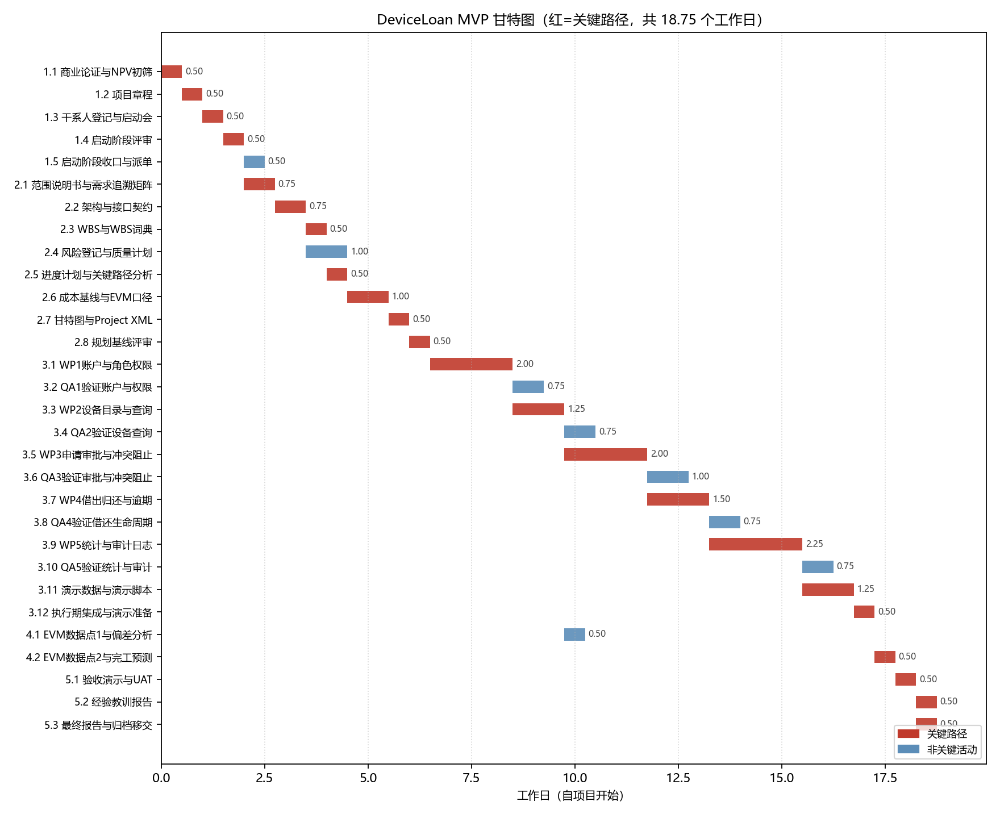
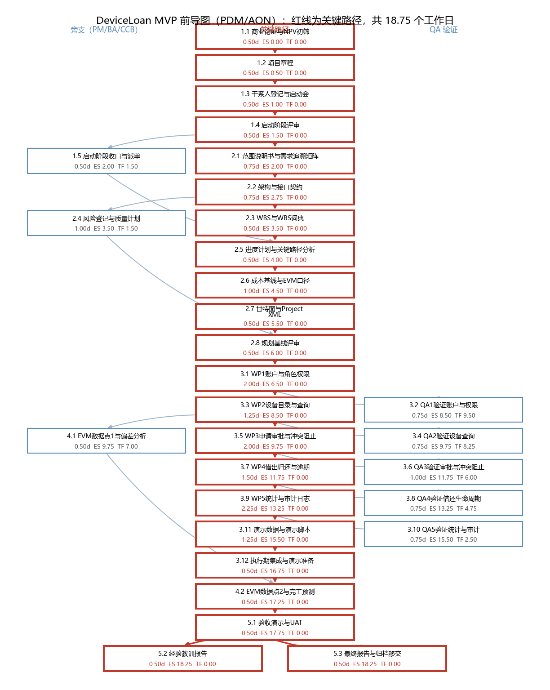
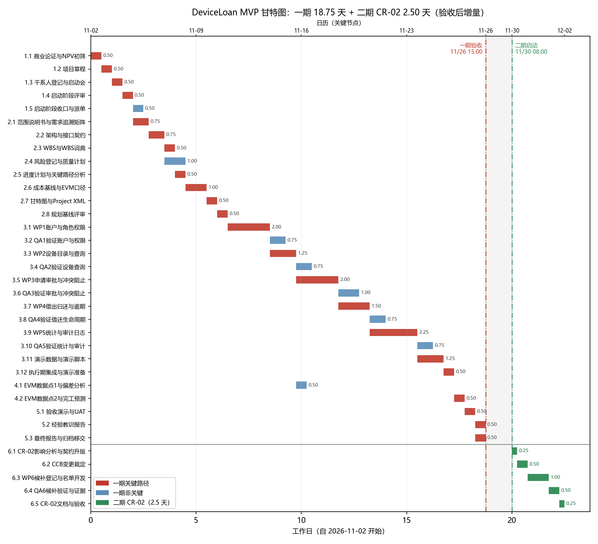
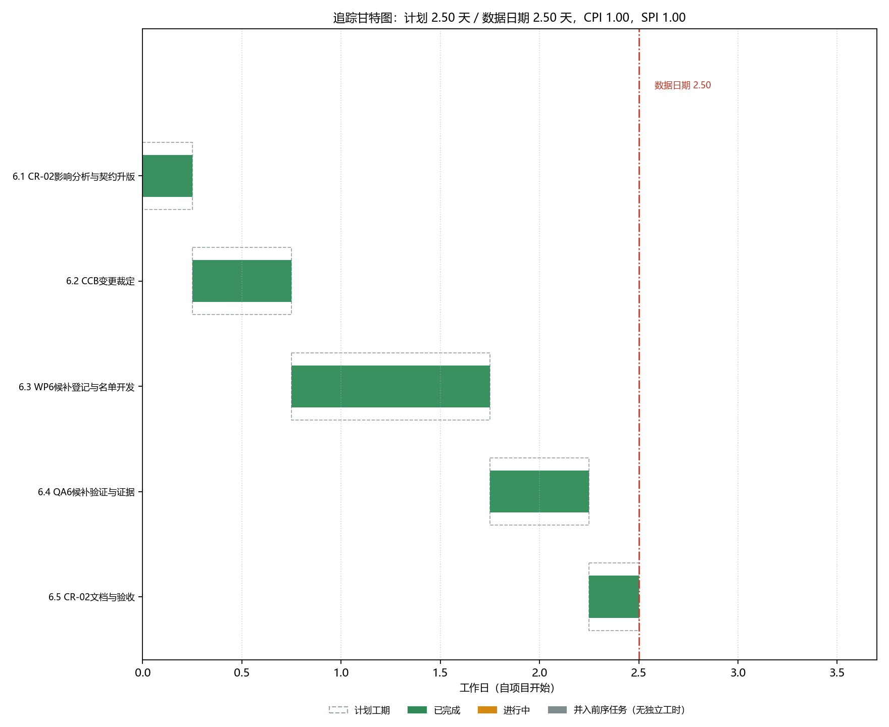
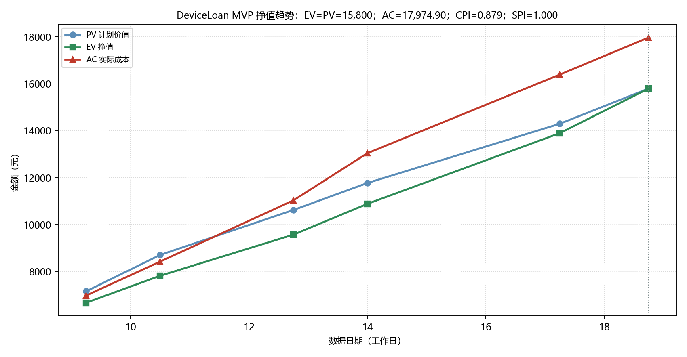
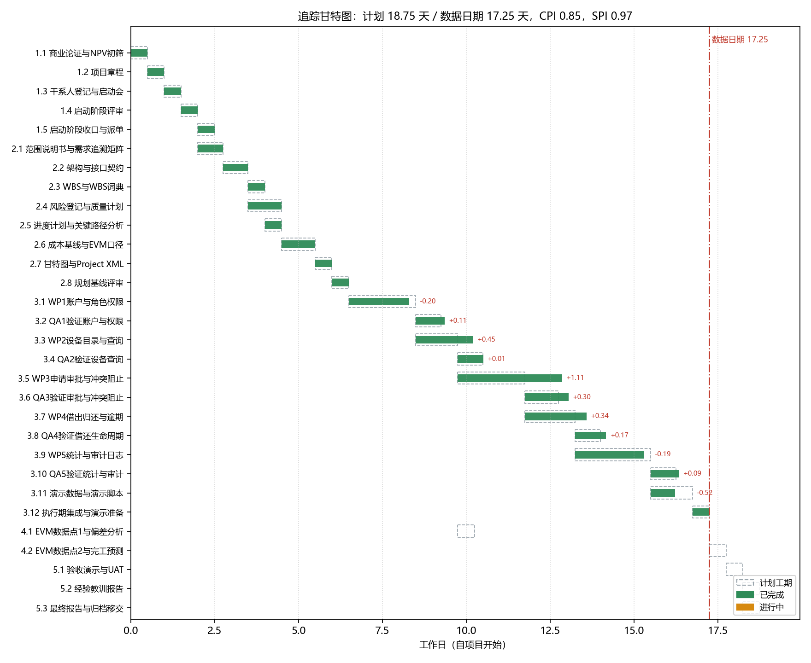

# 软件项目管理实验报告

## 基于多智能体的实验室设备借用管理系统（DeviceLoan MVP）项目管理模拟

| 项目 | 内容 |
|---|---|
| 课程 | 软件项目管理实验 |
| 项目名称 | 实验室设备借用管理系统（DeviceLoan MVP） |
| 组长 | 【待填】 |
| 组长学号 | 【待填】 |
| 组员 | 【待填】 |
| 组员学号 | 【待填】 |
| 指导教师 | 【待填】 |
| 完成日期 | 2026 年 10 月 |

<div style="page-break-after: always;"></div>

## 实验目的

1. 了解软件项目管理的基本概念和核心领域知识；
2. 掌握 Microsoft Project 的基本操作，能够导入 WBS、查看甘特图并检查工期与依赖；
3. 学会利用大模型和多智能体框架辅助完成软件项目管理与开发。

## 摘要

本实验以一个高校实验中心的设备借用管理场景为背景，设计并运行了一套基于大模型的多智能体软件开发框架，模拟从项目启动到收尾的完整管理过程。项目采用项目型组织结构，设置项目经理（PM）、业务分析与架构（BA）、开发者（Dev）、测试（QA）、变更控制委员会（CCB）五类智能体，由 PM 负责任务派发、进度与成本核算，BA 负责需求与契约，Dev 按契约实现，QA 独立验证，CCB 评审变更。项目以 Python 3.11 标准库 + SQLite 实现命令行 MVP，交付登录与权限、设备查询、借用申请与审批、冲突阻止、借出归还与逾期、统计与审计等 16 条基线需求，并在二期增量交付候补队列。

项目计划工期 20 个工作日，详细关键路径 18.75 天；为便于 MS Project 展示，将 30 个任务合并为 20 个整日任务，关键路径 19.75 天，仍满足 20 天承诺。成本基线 15,800 元（25.0 人日），批准预算 17,800 元，客户上限 19,700 元。最终挣值数据为 EV=15,800 元、AC=17,974.90 元、CV=−2,174.90 元、CPI=0.879、SPI=1.000，实际 28.81 人日；项目在 20 天内完成，成本超过批准预算 174.90 元，但仍在客户上限内。变更管理完整经历了 CR-01 的影响分析、CCB 裁定与 CR-02 二期交付，最终 84 条自动化测试全部通过。

**关键词**：多智能体；项目管理；WBS；关键路径；挣值管理；变更管理；MS Project

## 目录

1. 项目章程
2. 多智能体系统设计
3. 范围管理
4. 进度管理
5. 成本管理
6. 变更管理
7. 监控、质量与收尾
8. 总结与反思
9. 组员分工
附录：主要产物与复现说明

<div style="page-break-after: always;"></div>

# 1 项目章程

本章按项目章程的常见格式，给出项目基本信息、目标、成功标准、预算、方法、角色与制约条件。完整版本见仓库 `docs/02-charter.md`。

## 1.1 项目基本信息

| 字段 | 内容 |
|---|---|
| 项目名称 | 实验室设备借用管理系统（DeviceLoan MVP） |
| 客户 / 发起方 | 某高校实验中心 |
| 项目经理 | 【待填】 |
| 项目开始 | 第 1 个工作日（模拟日历：2026-11-02） |
| 计划完成 | 第 20 个工作日之前；详细计划 18.75 天，MS Project 整日版 19.75 天 |
| 团队形态 | 多智能体项目团队，成员以“职位 + 模型名称”标识 |
| 技术栈 | Python 3.11 标准库 + SQLite，命令行，零第三方依赖 |

## 1.2 项目背景与目标

实验中心目前用微信群 + Excel 登记设备借用，存在四类问题：同一设备同一时段被重复借出；借用、归还、逾期记录分散；期末统计靠手工汇总；学生无法自助查询设备状态。项目用一个命令行 MVP 验证“可查询、可审批、可追踪、可统计”的闭环，不要求一次性替代线下流程。

项目目标：

1. 消除同一设备同一时段的重复批准；
2. 学生可自助查询设备与本人申请；
3. 借出、归还、逾期由系统标记；
4. 借用次数、逾期率、设备利用率可自动统计；
5. 关键操作可审计；
6. 在 20 个工作日、19,700 元上限内完成，并保证 NPV 为正、回收期小于 12 个月。

## 1.3 成功标准

| 编号 | 成功标准 | 验证方式 |
|---|---|---|
| S1 | CRQ-01 至 CRQ-08 全部可演示 | 演示会逐条走查 |
| S2 | 同一设备同一时段冲突预约被阻止 | 固定冲突场景 + 自动化测试 |
| S3 | 自动化测试通过，无严重缺陷 | 测试运行记录 |
| S4 | 关键需求可追溯到 WBS 与测试用例 | RTM 与 WBS 交叉核对 |
| S5 | 20 个工作日内完成，修订成本 ≤ 19,700 元 | 进度与 EVM 记录 |
| S6 | NPV（3 年、10% 折现）为正，回收期 < 12 个月 | 商业论证复核 |

## 1.4 预算与储备

| 项目 | 金额（元） | 说明 |
|---|---:|---|
| 成本基线 BAC | 15,800 | 25.0 人日：PM 5.0、BA 5.0、Dev 10.0、QA 4.0、CCB 1.0 |
| 应急储备 | 2,000 | 占基线 12.7%，用于已识别风险 |
| 批准预算 | 17,800 | 成本基线 + 应急储备，即 NPV 的 C0 |
| 管理储备 | 1,900 | 未分配，动用须 CCB 批准 |
| 客户上限 | 19,700 | 硬约束；批准预算 + 管理储备 |

## 1.5 方法、角色与制约

- **过程组**：启动 → 规划 → 执行 → 监控 → 收尾；每个阶段有明确的交付物和评审点。
- **多智能体分工**：PM 派单与核算，BA 出需求与契约，Dev 实现工作包，QA 独立验证，CCB 评审变更；每个工作包完成后由 QA 出证据、PM 更新 EVM，再进入下一包。
- **主要制约**：工期 20 个工作日为固定上限；成本硬上限 19,700 元；技术栈锁定 Python 标准库 + SQLite；每个职位只由一个智能体承担，不设后备；客户签字与正式确认由人工完成。

## 1.6 签署

| 角色 | 姓名 | 签字 | 日期 |
|---|---|---|---|
| 发起人（实验中心主任） | 【待填】 | 【待填】 | 【待填】 |
| 项目经理 | 【待填】 | 【待填】 | 【待填】 |
| 客户代表（实验室管理员） | 【待填】 | 【待填】 | 【待填】 |

<div style="page-break-after: always;"></div>

# 2 多智能体系统设计

## 2.1 组织结构

本项目采用**项目型（Project-oriented）组织结构**，而不是职能型或强矩阵型。原因如下：

1. 项目目标单一、工期紧（20 个工作日），需要 PM 对范围、进度、成本快速决策；
2. 团队只有 5 个角色，且“单人单角色”，再设职能经理层只会增加沟通成本；
3. 团队不需要在多个项目之间分摊资源，项目型结构下授权最直接；
4. QA 不向 Dev 汇报，独立出证据，形成一条**弱矩阵监督线**，避免开发者自证。

| 结构 | 权力与资源 | 是否采用 |
|---|---|---|
| 职能型 | PM 权力最小，资源由职能经理分配 | 不采用 |
| 项目型 | PM 权力最大，团队专职服务单一项目 | **采用** |
| 矩阵型 | 成员同时向职能经理和 PM 汇报 | 不采用强矩阵；QA 保留弱矩阵监督线 |

## 2.2 角色分工、输入与输出

| 角色 | 职责 | 主要输入 | 主要输出 | 决策边界 |
|---|---|---|---|---|
| PM | 派单、排期、成本与挣值核算、集成、对外汇报 | 客户需求、各角色交付物、EVM、风险与变更 | 章程、WBS、进度/成本基线、状态报告、验收组织 | 可在基线内调整顺序；偏差 >10% 上报；动用管理储备须 CCB |
| BA | 需求与优先级、范围、架构与接口契约、WBS | 客户需求、变更请求、PM 任务单 | 商业论证、范围说明书、RTM、接口契约、WBS、变更影响分析 | 可提优先级建议；不直接改代码，不代替客户确认 |
| Dev | 按契约实现工作包并自测 | 工作包说明、接口契约、QA 缺陷单 | 源代码、数据库脚本、演示数据、演示脚本、自检说明 | 可选择实现方案；不直接对接客户，不改验收标准 |
| QA | 独立验证、缺陷记录、验收证据 | 验收标准、接口契约、Dev 交付物 | 测试用例、缺陷清单、测试记录、PASS/FAIL 证据 | 判定工作包是否通过；FAIL 退回 Dev，不计 EV |
| CCB | 评审变更，裁定批准/拒绝/延期 | 变更请求、影响分析、PM/BA 意见 | 裁定结论、影响分析归档、收尾追认 | 变更裁决权；未批准不进入开发 |
| 客户/发起人 | 提供需求与验收标准，签署章程与验收结论 | 周报、里程碑演示、变更影响 | 需求确认、验收结论、书面确认 | 验收与预算上限；不参与日常排期 |

> 说明：报告中 PM、Dev、QA、CCB 的模型名称可按实际使用情况填写；本实验的 BA 由 DeepSeek V4.1 Flash Free 承担，PM 通过 OpenCode 多智能体环境派发子任务。

## 2.3 智能体交互关系

```text
客户/发起人
    │ 需求、验收标准、变更
    ▼
   PM ──任务单──► BA ──接口契约──► Dev ──交付──► QA
    ▲               │                            │
    │               └──────────┐                 │ PASS/证据
    │ 偏差、风险                ▼                 ▼
    └──────────────────────  CCB  ◄── 变更请求 ──┘
                               │
                               └── 裁定：批准 / 拒绝 / 延期
```

| 从 → 到 | 触发 | 传递内容 | 产物 |
|---|---|---|---|
| 客户 → PM/BA | 提出需求或变更 | 业务问题、验收标准、变更诉求 | 需求档案、CR |
| PM → BA/Dev/QA | 阶段开始或工作包完成 | 任务单、优先级、截止时间 | 工作包说明、派单记录 |
| BA → Dev | 契约冻结 | 接口、数据模型、验收口径 | 接口契约 |
| Dev → QA | 工作包自测完成 | 代码、运行说明、自测结果 | 待验交付物 |
| QA → Dev | 测试失败 | 缺陷步骤、期望与实际 | 缺陷单 |
| QA → PM | 测试通过 | 证据包、覆盖率、结论 | QA 证据，计入 EV |
| PM/BA → CCB | 收到 CR | 范围、进度、成本、NPV 影响 | CCB 裁定 |
| PM → 客户 | 每周/里程碑 | 进度、成本、风险、演示 | 状态报告、验收记录 |

## 2.4 运行规则与自动化

**运行规则：**

1. 任务单是唯一派单入口，聊天中的临时要求必须落到任务单或变更请求；
2. 契约先行，BA 冻结接口契约后 Dev 才开工，开发中改契约按变更处理；
3. 证据驱动，QA 出证据才计 EV，测试未通过的工作包不进入下一包；
4. 变更统一走 CCB：CR → 影响分析 → 裁定 → 更新基线与台账；
5. 进度或成本偏差超过 10%，PM 当天上报；动用管理储备须 CCB 批准；
6. 章程、验收结论、财务参数确认由人工签字，不在智能体闭环内。

**自动化实现：**

- PM 在 OpenCode 中创建子代理会话，按工作包派发任务；Dev 只改 `src/`，QA 只写 `tests/` 和证据，角色边界通过任务说明和仓库约定约束。
- `tools/pm_metrics.py` 从 `plan/tasks.csv` 计算 CPM、关键路径、EVM、甘特图、网络图和 MS Project XML；`tools/gen_msp_wbs.py`、`tools/gen_cr02_gantt.py`、`tools/gen_cr02_msp.py`、`tools/merge_wbs.py` 生成整日版 WBS 和二期视图。
- 自动化测试使用 `unittest`，每次工作包和每次变更后重跑；`scripts/demo.py` 可一键生成演示数据。
- 所有文档、代码、测试、计划数据进入 Git，按阶段提交；报告中的图表由脚本从同一份 CSV 数据生成，避免手工改数。
- 人工介入点仅限：客户需求确认与签字、MS Project 截图、最终 PDF 整合与提交。

## 2.5 五个过程组与智能体映射

| 过程组 | 主要活动 | 主要负责智能体 | 关键产物/证据 |
|---|---|---|---|
| 启动 | 商业论证、章程、干系人登记、启动会 | BA、PM、CCB | `01-business-case.md`、`02-charter.md`、`03-*` |
| 规划 | 范围与 RTM、WBS、进度、成本、风险质量 | BA、PM、CCB | `04-scope.md`～`10-work-packages.md` |
| 执行 | WP1–WP6 开发、QA 验证、演示脚本 | Dev、QA、PM | `src/`、`tests/`、`docs/evidence/qa-wp*.md` |
| 监控 | EVM 数据点、状态报告、变更控制、纠偏 | PM、CCB | `plan/`、`stage3-log.md`、`stage4-monitor.md` |
| 收尾 | UAT、经验教训、归档移交 | PM、QA、BA | `uat.md`、`stage5-closeout.md` |

<div style="page-break-after: always;"></div>

# 3 范围管理

## 3.1 需求收集与范围定义

以客户需求档案 `00-customer-brief.md` 为唯一需求来源，BA 将需求整理为 9 条功能需求（CRQ-01～CRQ-09）和 7 条非功能需求（NFR-01～NFR-07），共 16 条基线。客户在演示后提出的候补队列 CRQ-10 作为变更候选，先走 CR-01，后在二期以 CR-02 交付。

**范围内：**

- 登录与 student/admin/director 三种角色的权限隔离；
- 设备按名称、类别、时段检索，输出是否可借；
- 提交、取消、批准、拒绝借用申请，拒绝必填原因；
- 同一设备同一时段重复批准的阻止；
- 借出、归还、逾期标记；
- 借用次数、逾期率、设备利用率统计；
- 关键操作审计日志；
- 演示数据初始化与演示脚本。

**范围外：**

- 候补通知、自动递补、取消候补（二期只做登记 + 名单）；
- Web/GUI、移动端 App；
- 与资产管理系统、学籍系统集成；
- 多校区、多院系数据隔离；
- 正式上线部署、运维值守、SLA；
- 历史 Excel 数据迁移、真实个人信息导入。

## 3.2 WBS

一期 WBS 共 30 个任务，按五个过程组分解；二期 CR-02 单独 5 个任务，不并入一期 30 个编号。为便于 MS Project 截图，另生成“整日版”WBS：把 30 个任务合并为 20 个，每个任务不少于 1 天，关键路径 19.75 天，仍满足 20 天承诺。

| 阶段 | 任务数 | 主要内容 | 人日 |
|---|---:|---|---:|
| 1 启动 | 5 | 商业论证、章程、干系人、启动评审、派单 | 2.5 |
| 2 规划 | 8 | 范围/RTM、架构、WBS、风险质量、进度、成本、XML、基线评审 | 5.5 |
| 3 执行 | 12 | WP1–WP5、QA1–QA5、演示脚本、集成 | 14.5 |
| 4 监控 | 2 | 两个 EVM 数据点与偏差分析 | 1.0 |
| 5 收尾 | 3 | UAT、经验教训、归档移交 | 1.5 |
| **一期合计** | **30** | — | **25.0** |
| 6 二期 CR-02 | 5 | 影响分析、CCB、WP6、QA6、文档验收 | 2.5 |

> **图 3-1 WBS（MS Project 截图，待插入）**
>
> 导入 `wbs/wbs-msp.xml` 后，在 Project 中切换到“任务工作表/大纲”视图，显示 WBS、任务名称、工期、开始、完成、前置任务、资源名称。若希望一张图同时显示一期与二期，导入 `wbs/wbs-all-msp.xml`；二期单列截图可导入 `wbs/wbs-cr02-msp.xml`。本报告用下表给出同源 WBS 结构，截图位置由提交者补充。

**一期 WBS 结构（与 `wbs/wbs-msp.xml` 的 20 个整日任务对应）：**

| WBS | 任务 | 负责人 | 工期(天) | 前置 |
|---|---|---|---:|---|
| 1.1 | 商业论证与项目章程 | BA | 1.0 | — |
| 1.2 | 干系人登记与启动阶段评审 | BA/CCB | 1.0 | 1.1 |
| 1.3 | 启动阶段收口与派单 | PM | 1.0 | 1.2 |
| 2.1 | 范围、需求与架构设计 | BA | 2.0 | 1.2 |
| 2.2 | 风险登记与质量计划 | BA | 1.0 | 2.1 |
| 2.3 | 进度计划与成本基线 | PM | 1.5 | 2.1;1.3 |
| 2.4 | 甘特图与规划基线评审 | PM/CCB | 1.0 | 2.3;2.2 |
| 3.1 | WP1 账户与角色权限 | Dev | 2.0 | 2.4 |
| 3.2 | QA1 验证账户与权限 | QA | 1.0 | 3.1 |
| 3.3 | WP2 设备目录与查询 | Dev | 1.25 | 3.1 |
| 3.4 | QA2 验证设备查询 | QA | 1.0 | 3.3 |
| 3.5 | WP3 申请审批与冲突阻止 | Dev | 2.0 | 3.3 |
| 3.6 | QA3 验证审批与冲突阻止 | QA | 1.0 | 3.5 |
| 3.7 | WP4 借出归还与逾期 | Dev | 1.5 | 3.5 |
| 3.8 | QA4 验证借还生命周期 | QA | 1.0 | 3.7 |
| 3.9 | WP5 统计与审计日志 | Dev | 2.25 | 3.7 |
| 3.10 | QA5 验证统计与审计 | QA | 1.0 | 3.9 |
| 3.11 | 演示脚本与执行期集成 | Dev/PM | 1.75 | 3.9 |
| 4.1 | EVM 偏差分析与完工预测 | PM | 1.0 | 3.11;3.3 |
| 5.1 | 验收演示、经验教训与归档移交 | PM/BA | 1.5 | 4.1 |

## 3.3 WBS 词典与工作包

| 工作包 | 范围 | 主要产物 | 验收/测试 |
|---|---|---|---|
| WP1 账户与角色权限 | 登录、PBKDF2 口令哈希、会话、三种角色权限 | `src/auth.py`、`src/db.py`、`audit_log` 表 | TC-CRQ-01、NFR-01/03/04/07 |
| WP2 设备目录与查询 | 设备列表、按名称/类别/时段检索、可借判定 | `src/devices.py` | TC-CRQ-02、NFR-02 |
| WP3 申请审批与冲突阻止 | 提交、取消、列表、详情、批准、拒绝、冲突判定 | `src/requests.py` | TC-CRQ-03/04/05/09 |
| WP4 借出归还与逾期 | 借出、归还、逾期判定 | `src/loans.py` | TC-CRQ-06 |
| WP5 统计与审计 | 借用次数、逾期率、利用率、审计查询 | `src/stats.py`、`src/audit.py` | TC-CRQ-07/08、NFR-05/06 |
| WP6 二期候补 | 候补登记、名单、去重、可用性提示、审计 | `src/waitlist.py`、`waitlists` 表 | TC-CRQ-10-01～04 |

范围控制的三个关键点：

1. **契约先行**：`05-architecture.md` 冻结表结构、命令参数、退出码和权限矩阵，Dev 不自行扩命令；
2. **RTM 闭环**：16 条基线需求都能追溯到工作包和测试用例；CRQ-10 在二期单独占 RTM 第 17 行；
3. **变更不走捷径**：任何新增表、命令、字段先提交 CCB，未批准不写代码。

## 3.4 范围确认

一期按 16 条基线完成 UAT，16/16 通过；二期按 AC1–AC4 验收候补队列，PASS。最终自动化测试 84 条（一期 76 + 二期 8），无严重缺陷。范围确认的证据包括 RTM、QA 各包证据、UAT 记录和演示脚本输出。

<div style="page-break-after: always;"></div>

# 4 进度管理

## 4.1 排期口径

- 30 个一期任务，依赖统一为“完成—开始（FS）”，无滞后；
- 工期单位工作日（8 小时），保留 0.25 天粒度；周末不计；
- 项目开始日 2026-11-02（周一）；
- 一个角色由一个智能体承担，同一角色同一时段只做一件事，不同角色可并行；
- 由 `tools/pm_metrics.py schedule` 从 `plan/tasks.csv` 计算，不手工调数。

## 4.2 关键路径分析

一期关键路径为：

`1.1 → 1.2 → 1.3 → 1.4 → 2.1 → 2.2 → 2.3 → 2.5 → 2.6 → 2.7 → 2.8 → 3.1 → 3.3 → 3.5 → 3.7 → 3.9 → 3.11 → 3.12 → 4.2 → 5.1 → 5.2`

| 段 | 任务 | 累计工作日 |
|---|---|---:|
| 启动 | 1.1 商业论证 → 1.2 章程 → 1.3 干系人 → 1.4 CCB 评审 | 2.00 |
| 规划 | 2.1 范围 → 2.2 契约 → 2.3 WBS → 2.5 进度 → 2.6 成本 → 2.7 图/XML → 2.8 基线评审 | 6.50 |
| 执行 | 3.1 WP1 → 3.3 WP2 → 3.5 WP3 → 3.7 WP4 → 3.9 WP5 → 3.11 演示数据 → 3.12 集成 | 17.25 |
| 监控/收尾 | 4.2 EVM 数据点 2 → 5.1 验收 → 5.2 经验教训 | 18.75 |

判读：执行段的 Dev 链（3.1→3.3→3.5→3.7→3.9）占 9.0 天，是最大的一段；规划段 4.5 天必须在第 6.5 个工作日前冻结，否则直接推迟交付。5.2 与 5.3 在 5.1 后并行，总浮动均为 0。





> **图 4-3 MS Project 甘特图（截图，待插入）**
>
> 导入 `wbs/wbs-msp.xml` 后，在 Project 中切换到“甘特图”视图，显示任务、工期、开始、完成、前置任务和资源名称。图中应能看到关键路径与 2026-11-27 的完成日期；二期组合视图可导入 `wbs/wbs-all-msp.xml`。

## 4.3 关键链与缓冲（CCPM）

| 项 | 值 | 说明 |
|---|---:|---|
| 关键链（压缩后） | 9.38 天 | 把关键路径上 21 个任务的工期各砍 50%，去掉个人安全时间 |
| 项目缓冲 PB | 4.69 天 | 砍下来的安全时间的一半，集中放在项目末端 |
| 带缓冲的计划 | 14.06 天 | 关键链 + PB |
| 对外承诺 | 20 天 | 客户上限；与带缓冲计划之间有 5.94 天余量 |

监控规则：每个 EVM 数据点计算“缓冲消耗率 = 已消耗缓冲 ÷ PB”。低于 33% 为绿色；33%–67% 为黄色，检查关键链；高于 67% 启动纠偏。由于本项目单角色单智能体，资源约束与逻辑约束重合，关键链活动集合与关键路径相同，差别只在“压缩工期 + 聚合缓冲”的处理方式。

## 4.4 里程碑

| 里程碑 | 计划位置 | 判定条件 |
|---|---|---|
| M1 启动批准 | 第 2.0 天 | CCB 出具有条件批准，章程 v1.1 |
| M2 基线冻结 | 第 6.5 天 | 范围/进度/成本三基线评审通过 |
| M3 核心闭环可演示 | 第 12.75 天 | WP3 验证通过（冲突拦截可用） |
| M4 全部功能完成 | 第 17.25 天 | WP5 验证 + 演示脚本可跑 |
| M5 验收 | 第 18.25 天 | 按 S1–S6 逐条走查通过 |
| M6 二期 CR-02 验收 | 2026-12-02 12:00 | AC1–AC4 PASS、84 条测试全绿 |

## 4.5 进度执行与纠偏

| 数据日期 | SPI | 主要状态 |
|---:|---:|---|
| 9.25 | 0.932 | WP1 完成，QA1 与 WP2 串行，早段偏慢 |
| 10.50 | 0.898 | WP2 返工 2 次，进度落后 |
| 12.75 | 0.901 | WP3 失败率 22%，启动质量前置 |
| 14.00 | 0.925 | WP4 完成，QA 与下一包并行 |
| 17.25 | 0.972 | 赶工 + 范围置换，接近计划 |
| 18.75 | 1.000 | 全部任务完成，按 20 天承诺收尾 |

纠偏措施及效果：

1. **质量前置**：Dev 派单附契约自检矩阵，WP4 返工 1 次、WP5 0 次，失败率从 22% 降到 4.5%；
2. **恢复计划并行**：QA 在冻结快照上测试，与下一个开发包并行，SPI 从 0.90 回升到 0.97；
3. **赶工**：Dev2 并行做 WP5 和演示脚本，节省约 0.87 天，但赶工成本 758 元；
4. **范围置换**：演示脚本瘦身、合并 4.1/4.2、归档并入 5.2，节省约 1.5 天，成本为 0。

最终 SPI=1.000，项目在 20 天承诺内完成。MS Project 整日版为 19.75 天，是因为每个任务按整日取整，比详细计划多 1 天，但仍未超过 20 天。

## 4.6 二期 CR-02 排期

二期在一期验收后启动，单独排 5 个任务，不占用一期 20 天窗口。

| WBS | 任务 | 负责人 | 人日 | 工期(天) | 前置 |
|---|---|---|---:|---:|---|
| 6.1 | CR-02 影响分析与契约升版 | BA | 0.25 | 0.25 | — |
| 6.2 | CCB 变更裁定 | CCB | 0.5 | 0.5 | 6.1 |
| 6.3 | WP6 候补登记与名单开发 | Dev | 1.0 | 1.0 | 6.2 |
| 6.4 | QA6 候补验证与证据 | QA | 0.5 | 0.5 | 6.3 |
| 6.5 | CR-02 文档与验收 | PM | 0.25 | 0.25 | 6.4 |

二期 2026-11-30 08:00 开始，2026-12-02 12:00 完成，共 2.5 个工作日；关键路径 6.1→6.2→6.3→6.4→6.5，总浮动 0。





<div style="page-break-after: always;"></div>

# 5 成本管理

## 5.1 成本估算与基线

采用自下而上估算：每个 WBS 任务按角色给“人日 × 虚拟日薪”，加总得成本基线。虚拟日薪固定，不按 token 折算，避免口径漂移。

| 角色 | 日薪（元） | 人日 | 金额（元） |
|---|---:|---:|---:|
| PM | 800 | 5.0 | 4,000 |
| BA | 600 | 5.0 | 3,000 |
| Dev | 650 | 10.0 | 6,500 |
| QA | 450 | 4.0 | 1,800 |
| CCB | 500 | 1.0 | 500 |
| **合计** | — | **25.0** | **15,800** |

## 5.2 储备与预算

| 项 | 金额（元） | 用途 |
|---|---:|---|
| 成本基线 BAC | 15,800 | 25.0 人日 |
| 应急储备 | 2,000 | 已识别高风险（返工、补测、赶工） |
| 批准预算 | 17,800 | BAC + 应急 |
| 管理储备 | 1,900 | 变更评审、未识别风险、超支 |
| 客户上限 | 19,700 | 硬约束 |

## 5.3 NPV 与投资回收期

年度净现金流 = B1 节省工时 19,200 + B2 减少重复采购 5,000 − O1 运维 1,200 = **23,000 元/年**。

| 年度 | 净现金流（元） | 折现因子（10%） | 现值（元） | 累计现值（元） |
|---:|---:|---:|---:|---:|
| 0 | −17,800 | 1.000000 | −17,800.00 | −17,800.00 |
| 1 | 23,000 | 0.909091 | 20,909.09 | 3,109.09 |
| 2 | 23,000 | 0.826446 | 19,008.26 | 22,117.35 |
| 3 | 23,000 | 0.751315 | 17,280.24 | 39,397.59 |

- NPV ≈ **+39,398 元 > 0**，满足成功标准；
- 投资回收期 = 17,800 ÷ 23,000 = 0.77 年 ≈ **9.3 个月 < 12 个月**；
- 3 年 ROI ≈ **287.6%**；
- 组合敏感性（B1、B2 同时降 25%）下，年净现金流 16,950 元，NPV ≈ **+24,352 元**，回收期约 12.6 个月，作为已接受偏差记录。

## 5.4 挣值管理

| 数据日期 | PV | EV | AC | CV | CPI | SPI |
|---:|---:|---:|---:|---:|---:|---:|
| 9.25 | 7,162.50 | 6,675.00 | 6,982.00 | −307.00 | 0.956 | 0.932 |
| 10.50 | 8,712.50 | 7,825.00 | 8,429.00 | −604.00 | 0.928 | 0.898 |
| 12.75 | 10,625.00 | 9,575.00 | 11,035.50 | −1,460.50 | 0.868 | 0.901 |
| 14.00 | 11,775.00 | 10,887.50 | 13,045.50 | −2,158.00 | 0.835 | 0.925 |
| 17.25 | 14,300.00 | 13,900.00 | 16,394.90 | −2,494.90 | 0.848 | 0.972 |
| **18.75 收尾** | **15,800.00** | **15,800.00** | **17,974.90** | **−2,174.90** | **0.879** | **1.000** |



最终 EAC = AC = 17,974.90 元，VAC = −2,174.90 元。成本超过批准预算 174.90 元，由管理储备支出；仍在客户上限 19,700 元内，剩余 1,725.10 元。

## 5.5 偏差原因与纠偏

| 因素 | 影响 | 说明 |
|---|---|---|
| 返工 4 次 | 约 1,150 元 | WP2、WP3、WP4 的状态机与边界处理返工 |
| 子代理失败率平均 13% | 约 1,000 元 | 工具调用失败、输出不合契约导致的额外人日 |
| CR-01 评审 | 400 元 | 影响分析 0.25 人日 + CCB 评审 0.5 人日，由管理储备支出 |
| 赶工 | 758 元 | Dev2 并行做 WP5 + 演示脚本，由应急储备支出 |
| 范围置换 | 0 元 | 演示脚本瘦身、合并 4.1/4.2、归档并入 5.2，节省约 1.5 天 |

偏差集中在 WP2–WP4，WP5 通过“派单附契约自检矩阵”把失败率降到 4.5%，证明质量前置的收益大于事后返工。注：上表因素口径不同、存在交叉，不能简单相加等于 CV，表中列的是主要偏差来源。

## 5.6 二期 CR-02 成本

| 角色 | 人日 | 金额（元） |
|---|---:|---:|
| BA | 0.25 | 150 |
| CCB | 0.50 | 250 |
| Dev | 1.00 | 650 |
| QA | 0.50 | 225 |
| PM | 0.25 | 200 |
| **合计** | **2.50** | **1,475** |

二期成本单列，不占一期 BAC、应急储备或管理储备，不计入一期 CPI/SPI；二期自身 PV=EV=AC=1,475 元，CPI=SPI=1.00。

<div style="page-break-after: always;"></div>

# 6 变更管理

## 6.1 变更控制流程

```text
客户提出 CR
   │
   ▼
PM 登记变更请求 ──► BA 影响分析（范围/进度/成本/NPV/风险）
   │
   ▼
CCB 评审 ──► 批准 / 有条件批准 / 拒绝 / 延期
   │
   ├─ 未批准：记录理由，基线不变
   └─ 批准：更新 RTM、WBS、进度/成本基线 → 开发 → QA 回归 → 收尾归档
```

变更控制的三条底线：未批准不开发；影响分析必须标数据日期；批准后必须更新基线、台账和验收口径。

## 6.2 CR-01：候补队列的影响分析与裁定

客户在 MVP 演示后提出候补队列：设备不可用时学生可登记，管理员可查看名单；通知、自动递补不在范围。BA 做了三方案对比：

| 方案 | 内容 | 人日 | 成本（元） | 关键路径 | 结论 |
|---|---|---:|---:|---:|---|
| A 完整 | 登记 + 名单 + 取消 + 去重联动 | 3.25 | 1,912.50 | 20.25 天 | 超 20 天，且逼近客户上限 |
| B 最小 | 登记 + 名单 + 应用层去重，无取消 | 2.50 | 1,475.00 | 19.75 天 | 影响分析推荐 |
| C 不实现/延后 | 维持基线 | 0 | 0 | 18.75 天 | 客户诉求落空 |

影响分析最初推荐方案 B。但 CCB 在项目第 12.75 天复核时发现，影响分析使用的 10.50 数据点已经过期：当时缓冲只剩 0.09 天，方案 B 按最新数据重算为 **20.91 天、EAC 19,493.50 元**，会同时突破 20 天承诺和成本上限。CCB 因此裁定 **B——有条件批准、延后实施**：认可需求，纳入二期首批，但本次迭代不交付，范围、进度、成本基线不变。

这次裁定体现了变更管理中的两个要点：

1. **影响分析必须带数据日期**，不能用旧的缓冲读数做批准依据；
2. **变更不是“客户提了就做”**，要在范围、进度、成本、风险之间做取舍，必要时分期。

## 6.3 CR-02：候补队列的二期交付

一期验收后，客户坚持要实际交付候补功能。PM 另开 CR-02，CCB 裁定“有条件批准”，作为一期验收后的二期增量：

| 项 | 内容 |
|---|---|
| 范围 | `waitlist join` 登记、`waitlist list` 名单；同人同设备重叠时段去重；`available_now` 提示；审计 `waitlist_join` |
| 不做 | 通知、自动递补、取消候补、候补转正式申请 |
| 与冲突规则的关系 | 候补不占时段，`request approve` 的冲突判定完全不改 |
| 成本 | 2.5 人日 / 1,475 元，单列，不占一期储备 |
| 排期 | 2026-11-30 08:00 → 2026-12-02 12:00，2.5 天 |
| 对一期影响 | 范围、进度、成本基线、EVM、16 条验收均不变 |

验收口径 AC1–AC4：

| AC | 判定 | 结果 |
|---|---|---|
| AC1 | `waitlist join` 成功：退出码 0，库中 1 条 `waiting`，审计 `waitlist_join` 1 条 | PASS |
| AC2 | 同人同设备重叠时段重复登记：退出码 1，库无新增 | PASS |
| AC3 | 候补不占位：有/无 `waiting` 的 approve 结果一致；原冲突仍返回 4 | PASS |
| AC4 | 可见性：student 仅本人、admin `--all` 全部、director 退出码 3 | PASS |

二期新增 8 条测试，全量 84 条通过。CCB 的附加条件“超 3 人日或 1,800 元即停工回报”未被触发。

## 6.4 变更管理小结

- CR-01 完成了“提出 → 影响分析 → CCB 裁定 → 基线不变/延期”的闭环；
- CR-02 完成了“客户坚持 → 重新裁定 → 二期增量 → QA 验收 → 归档”的闭环；
- 一期基线始终冻结，二期单独记账，避免用二期成本污染一期 CPI/SPI；
- 变更管理的核心不是“全部拒绝”或“全部接受”，而是让每个决定都有数据、有边界、有验收。

<div style="page-break-after: always;"></div>

# 7 监控、质量与收尾

## 7.1 监控机制

PM 在每个工作包完成后更新 `plan/progress.csv`、`plan/actuals.csv`，运行 `tools/pm_metrics.py track` 生成追踪甘特图和 EVM 数据。监控阈值：

- 进度或成本偏差超过 10%，当天上报发起人；
- CPI < 0.9 进入关注，CPI < 0.85 启动纠偏；
- SPI < 0.9 检查关键路径，必要时并行 QA 或范围置换；
- 动用管理储备须 CCB 批准。



## 7.2 质量与风险控制

质量控制的组织保证是“Dev 不写测试、QA 不改产品代码”。每个工作包必须通过 QA 出口准则才计入 EV；测试未通过则退回 Dev，不进入下一包。最终 84 条测试全绿，严重缺陷 0，关键查询耗时约 0.0024 秒，满足小于 1 秒的 NFR-02。

主要风险及应对：

| ID | 风险 | 应对 |
|---|---|---|
| R1 | 时段冲突边界（跨天、首尾相接、未归还借出）出错 | 半开区间唯一口径；TC-CRQ-05-01/02 闸门用例 |
| R2 | 20 天偏紧，变更或返工挤占人力 | 关键路径优先；变更走 CCB；储备分级使用 |
| R3 | 客户不在现场，需求理解偏差 | 客户需求档案为唯一来源；UAT 逐条走查 |
| R4 | 命令行演示说服力不足 | 固定演示脚本 + 集成彩排，重点展示冲突退出码 4 |
| R5 | 成本上限 19,700 元 | 基线 + 应急内执行；超支动管理储备须 CCB |
| R6 | CRQ-10 获批后挤占关键路径 | 未批准不写代码；批准后单独排期/二期交付 |
| R7 | 口令哈希或角色校验错误 | PBKDF2 + 权限矩阵；越权路径统一退出码 3 |
| R8 | 演示数据与测试数据混用 | `--db` 切换库；QA 用独立临时库 |

## 7.3 收尾与验收

一期 UAT 按 S1–S6 逐条走查，16/16 需求通过，76 条测试全绿，无产品缺陷；结论为“有条件通过”，三个条件 C1–C3 均已闭环：

- C1：补 NFR-07 追溯用例；
- C2：补客户使用须知（UTC、单机单会话、按名称检索）；
- C3：CCB 追认储备动用、CR-01 结案、敏感性偏差。

二期 CR-02 按 AC1–AC4 验收，8 条测试通过，全量 84 条通过。最终归档包括需求、架构、WBS、进度、成本、风险质量、工作包、QA 证据、UAT、变更记录和经验教训。

<div style="page-break-after: always;"></div>

# 8 总结与反思

## 8.1 结果总结

| 项 | 计划 | 实际 | 结论 |
|---|---:|---:|---|
| 工期 | 18.75 天（承诺 20 天） | 18.75 天（SPI 1.000） | 满足 |
| 成本 | BAC 15,800 元（批准 17,800） | 17,974.90 元 | 超批准 174.90 元，仍低于 19,700 |
| 人日 | 25.00 | 28.81 | +15.2% |
| 需求 | 16 条基线 | 16/16 通过 | 满足 |
| 二期 | CR-02 2.5 天 / 1,475 元 | 2.5 天 / 1,475 元 | 满足 |
| 测试 | 一期 76 条 | 84 条（含二期 8 条） | 全部通过 |

## 8.2 经验教训

1. **返工与工具调用失败率是成本偏差的主因**：4 次返工约 1,150 元，失败率平均 13%，合计约占 CV 的一半；
2. **质量前置的收益远大于事后返工**：WP5 失败率 4.5%，偏差 −0.10 人日；前四包平均 13%；
3. **多分支逻辑的估算要乘系数**：WP3 状态机 + 事务回滚，计划 2.00 人日，实际 3.11 人日（+56%），这类包应按 1.4–1.6 估算；
4. **串行执行会吃掉并行度**：QA1 与 WP2 串行导致早段 SPI 0.93；QA 在冻结快照上测试、与下一包并行后 SPI 回升；
5. **赶工很贵，范围置换便宜**：赶工 0.87 天要 758 元；演示脚本瘦身省 0.52 人日、成本 0；
6. **决策材料必须标数据日期**：CR-01 影响分析用了过期缓冲读数，CCB 复核后改判延期；
7. **分级储备要用对地方**：应急储备只用于赶工（758 元），管理储备只用于变更与超支（400 + 174.90 元）。

## 8.3 自动化与局限

**自动化程度：** 任务派发、代码实现、测试、证据生成、EVM/甘特/网络图/XML 生成均由脚本或智能体完成；PM 只在阶段闸门做取舍和集成；人工介入主要是客户确认、签字、MS Project 截图和 PDF 整合。整个过程以 `plan/tasks.csv` 为单一数据源，文档、图表、EVM 和 WBS 使用同一套数据，减少了手工改数造成的口径漂移。

**局限：**

- 单人单角色，无后备；角色不可用时只能调整工作包顺序；
- 智能体之间以文档和任务单异步交互，不模拟实时会议；
- 演示数据为小规模虚构数据，未做真实并发、权限穿透和性能压测；
- 客户与发起人是人类角色，需求确认和签字无法自动化；
- 项目日历是模拟日历，实际交付时间与报告中的计划日期不是同一时间轴。

<div style="page-break-after: always;"></div>

# 9 组员分工

> 下表中的姓名、学号由提交者填写；如小组人数不同，可合并或拆分任务，但应保证“需求—开发—测试—变更—报告”每条线都有明确负责人。

| 姓名 | 学号 | 角色 | 主要任务 | 对应产物 |
|---|---|---|---|---|
| 【待填】 | 【待填】 | 组长 / PM | 总体统筹、任务派发、进度与成本核算、EVM、报告整合、MS Project 截图 | 章程、WBS、进度/成本基线、状态报告、本报告 |
| 【待填】 | 【待填】 | BA | 需求分析、范围说明、架构契约、RTM、WBS、变更影响分析 | `01`、`04`、`05`、`06`、`cr01-impact.md` |
| 【待填】 | 【待填】 | Dev | WP1–WP6 实现、数据库、演示数据、演示脚本、自检 | `src/`、`scripts/demo.py`、`README.md` |
| 【待填】 | 【待填】 | QA | 测试用例、QA 证据、UAT、缺陷跟踪 | `tests/`、`qa-wp*.md`、`uat.md` |
| 【待填】 | 【待填】 | CCB / 文档 | 变更评审、储备追认、归档、报告校对 | `ccb-cr01.md`、`ccb-cr02.md`、`stage5-closeout.md` |

**AI 使用说明：** 本实验使用大模型多智能体框架辅助完成需求分析、代码实现、测试和文档生成；所有产物由小组成员复核、运行和整合，姓名/学号与最终结论由人工负责。

<div style="page-break-after: always;"></div>

# 附录 A 主要产物索引

| 类别 | 文件/目录 |
|---|---|
| 商业论证与章程 | `docs/01-business-case.md`、`docs/02-charter.md` |
| 干系人与团队 | `docs/03-stakeholders-kickoff.md`、`docs/03a-team-structure.md` |
| 范围与架构 | `docs/04-scope.md`、`docs/05-architecture.md` |
| WBS 与进度 | `docs/06-wbs.md`、`docs/07-schedule.md`、`plan/tasks.csv`、`wbs/wbs-msp.xml` |
| 成本与 EVM | `docs/08-cost.md`、`plan/track.png`、`plan/evm.png` |
| 风险与质量 | `docs/09-risk-quality.md`、`tests/`、`docs/evidence/qa-wp*.md` |
| 工作包 | `docs/10-work-packages.md` |
| 变更 | `docs/evidence/cr01-impact.md`、`ccb-cr01.md`、`ccb-cr02.md` |
| 收尾 | `docs/evidence/uat.md`、`stage5-closeout.md` |
| 二期 | `plan/tasks-cr02.csv`、`plan/gantt-cr02.png`、`wbs/wbs-cr02-msp.xml` |

# 附录 B 复现命令

```powershell
# 初始化与演示
python src/main.py init-db --db data/deviceloan.db
python src/main.py seed --db data/deviceloan.db
python scripts/demo.py --db data/demo.db --force

# 全量测试
python -m unittest discover -s tests

# 排期、EVM、甘特图、网络图、WBS XML
python tools/pm_metrics.py schedule
python tools/pm_metrics.py evm --date 18.75
python tools/pm_metrics.py gantt
python tools/pm_metrics.py network
python tools/pm_metrics.py xml

# 二期视图
python tools/gen_cr02_gantt.py
python tools/gen_cr02_msp.py
python tools/merge_wbs.py
```

# 附录 C 图片与截图清单

| 图 | 文件 | 说明 |
|---|---|---|
| 图 4-1 | `plan/gantt.png` | 一期甘特图（Python 生成，与 Project 导入文件同源） |
| 图 4-2 | `plan/network.png` | PDM/AON 前导图与关键路径 |
| 图 4-3 | 【MS Project 截图】 | 导入 `wbs/wbs-msp.xml` 后截取甘特图 |
| 图 3-1 | 【MS Project 截图】 | 导入 `wbs/wbs-msp.xml` 后截取 WBS/任务工作表 |
| 图 4-4 | `plan/gantt-cr02.png` | 一期 + 二期组合甘特图 |
| 图 4-5 | `plan/track-cr02.png` | 二期追踪甘特图 |
| 图 5-1 | `plan/evm.png` | EVM 趋势图 |
| 图 7-1 | `plan/track.png` | 一期追踪甘特图 |

> 截图说明：`wbs/1792819797872.png` 是实验过程中早期的 Project 任务录入检查截图，任务数与日期和最终 20 任务版不一致，**不建议**放入正式报告。正式截图请以 `wbs/wbs-msp.xml`（一期 19.75 天）、`wbs/wbs-cr02-msp.xml`（二期 2.5 天）或 `wbs/wbs-all-msp.xml`（合并视图）导入后重新截取。

> 仓库地址：https://github.com/MikeHuang2000/Project-Management-Course-Lab1
